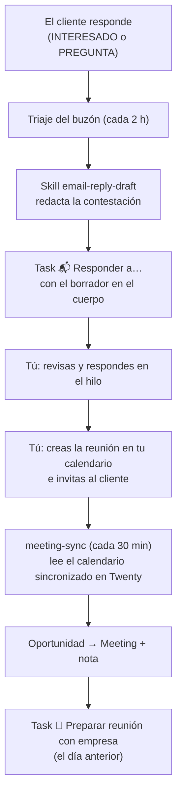
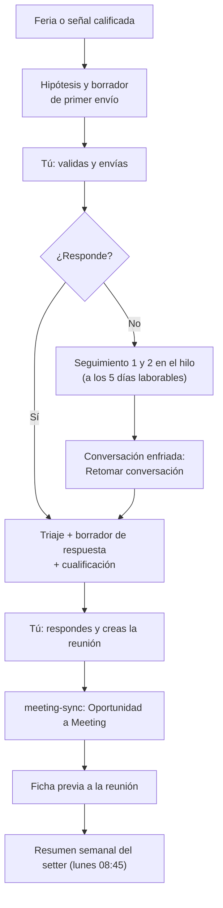

# AI Setter: del contacto a la reunión agendada

El **AI Setter** es el papel que el Commercial OS asume desde la tanda 22: **convertir contactos en reuniones agendadas**. Hasta la tanda 21 el sistema llegaba a «tienes una respuesta interesada en tu bandeja». A partir de ahora, además, te deja la contestación redactada, te propone huecos reales de tu calendario y, cuando la reunión existe, mueve la oportunidad y te prepara la reunión.

Este documento explica el modelo (niveles de autonomía y embudo), el ciclo completo de la tanda A (hecha y probada), las piezas de la tanda B (hecha: secuencias de seguimiento, retomar conversación, cualificación, huecos que respetan el plazo del cliente y títulos sin emoji delante) y las de la tanda C (la última: ficha previa a la reunión, métricas del setter y la regla del «vosotros»). Termina con [el AI Setter completo](#el-ai-setter-completo), el embudo de punta a punta. Lo que haces tú día a día está en la [guía del equipo comercial](guia-comercial.md#responder-y-cerrar-reuniones); la configuración, en el [runbook](runbook-local.md).

> **Nota:** la tanda A está reconciliada con la implementación de la tanda 22. La tanda B (tanda 23) está reconciliada con la implementación del FollowUpAgent v2. La tanda C (tanda 24) se documentó mientras se implementaba: todo lo que depende del código y aún no está contrastado va marcado `[POR CONFIRMAR]`. Si un nombre de variable, tarea o skill difiere del código, manda el [README del runtime](../runtime/agent-runtime/README.md).

## Contenido

1. [Qué es el AI Setter en PubliEXPE](#qué-es-el-ai-setter-en-publiexpe)
1. [Los tres niveles de autonomía](#los-tres-niveles-de-autonomía)
1. [Por qué el nivel 1](#por-qué-el-nivel-1)
1. [El embudo por etapas y qué cubre cada tanda](#el-embudo-por-etapas-y-qué-cubre-cada-tanda)
1. [El ciclo de la tanda A de punta a punta](#el-ciclo-de-la-tanda-a-de-punta-a-punta)
1. [La propuesta de reunión](#la-propuesta-de-reunión)
1. [Tanda A: hecha y probada](#tanda-a-hecha-y-probada)
1. [La detección de reuniones](#la-detección-de-reuniones)
1. [Tanda B: secuencias, cualificación y huecos con plazo](#tanda-b-secuencias-cualificación-y-huecos-con-plazo)
1. [Tanda C: ficha previa, métricas y trato de vosotros](#tanda-c-ficha-previa-métricas-y-trato-de-vosotros)
1. [El AI Setter completo](#el-ai-setter-completo)
1. [Lo que el sistema no hace](#lo-que-el-sistema-no-hace)
1. [Requisitos](#requisitos)
1. [Documentos relacionados](#documentos-relacionados)

## Qué es el AI Setter en PubliEXPE

En ventas, un *setter* es quien consigue que el cliente interesado acabe en una reunión con quien cierra. En PubliEXPE ese trabajo es repetitivo y se hace tarde: una respuesta interesada espera horas, el comercial redacta desde cero, propone «cuando quieras» y la conversación se enfría.

El AI Setter ataca ese tramo concreto: **desde que el cliente contesta hasta que hay una reunión en el calendario**. Su medida de éxito es una sola: reuniones agendadas.

## Los tres niveles de autonomía

| Nivel | Qué hace el sistema | Qué hace el humano | Riesgo |
|---|---|---|---|
| **1. Prepara** | Redacta la respuesta, propone huecos, detecta la reunión y prepara la siguiente tarea. | Revisa, **envía** y **agenda**. | Mínimo: nada sale sin un clic humano. |
| **2. Envía con límites** | Envía respuestas de bajo riesgo (por ejemplo, confirmaciones) dentro de reglas fijas. | Supervisa y atiende lo que el sistema no puede resolver. | Medio: un error llega al cliente. |
| **3. Agenda y conversa** | Mantiene la conversación, crea eventos y envía invitaciones por su cuenta. | Entra cuando la reunión ya existe. | Alto: reputación del dominio y compromisos en tu nombre. |

## Por qué el nivel 1

**Decisión del usuario, 2026-11-26: nivel 1.** El sistema prepara todo; tú envías y agendas. Nada sale solo.

Motivos que sostienen la decisión:

- **Es coherente con todo lo construido.** Desde la tanda 1 el principio es que el sistema propone y el humano decide; el envío con un clic y la lista de supresión ya funcionan así.
- **Protege el dominio.** `publiexpe.info` sigue en [calentamiento](email-warmup.md); un error automático costaría reputación.
- **Un borrador mal redactado cuesta un clic; un correo mal enviado, no.** El nivel 1 convierte los fallos del modelo en borradores descartados, no en incidentes.
- **Permite medir antes de soltar.** Con el nivel 1 se acumulan datos (cuántos borradores envías tal cual, cuántas reuniones salen) para decidir más adelante si el nivel 2 compensa.

> **Nota:** subir de nivel es una decisión nueva del usuario, no un ajuste de configuración. Ninguna tanda actual lo habilita.

## El embudo por etapas y qué cubre cada tanda

El AI Setter se construye en tres tandas. La **A** (tanda 22) y la **B** (tanda 23) están hechas y probadas; la **C** (tanda 24, en curso) es la última y cierra el embudo.

| Etapa del embudo | Qué ocurre | Tanda |
|---|---|---|
| Prospección y primer envío | Ferias → hipótesis → borrador → tu clic | Ya existe (tandas 1 a 21) |
| Sin respuesta | Aviso 🔔 a los 5 días laborables | Ya existe (tanda 21); desde la tanda 23 es una secuencia (B) |
| **Respuesta del cliente → reunión** | Borrador de respuesta, propuesta de huecos, detección de la reunión, tarea de preparación | **A — tanda 22 (hecha y probada)** |
| **Secuencias y cualificación** | Hasta 2 seguimientos con borrador en el mismo hilo; «Retomar conversación»; cualificación volcada a la Oportunidad; huecos que respetan el plazo del cliente | **B — tanda 23 (hecha)** |
| **Traspaso y métricas** | Ficha previa a la reunión («Preparar reunión» con ficha), métricas del setter y resumen semanal | **C — tanda 24 (en curso)** |

Las etapas de la Oportunidad en Twenty son `New → Screening → Meeting → Proposal → Customer`. La tanda A toca una sola transición: **a `Meeting`**.

## El ciclo de la tanda A de punta a punta

1. **El cliente responde.** El [triaje del inbound](inbound-triaje.md), que corre cada 2 horas, clasifica la respuesta. Si es `INTERESADO` o `PREGUNTA`, sigue con el borrador.
1. **El sistema redacta.** Una skill versionada, `email-reply-draft` (v1, la genera el triaje del buzón `process-inbox` cada 2 horas), escribe la contestación: responde a lo que dijo el cliente, no inventa precios ni stock, no mete urgencias, firma como PubliEXPE («expertos en merchandising») y termina proponiendo una reunión.
1. **El borrador llega a tu bandeja.** Va en el cuerpo de la Task **📬 «Responder a…»**, listo para copiar y responder en el hilo. Si el cliente ya propone o acepta una reunión, la Task pasa a **📅 «Cerrar reunión con {empresa}»** y el borrador se centra en confirmar la fecha.
1. **Tú decides y envías.** Lees, ajustas y respondes en el hilo desde tu correo. El sistema no envía nada.
1. **Tú agendas.** Creas la reunión en tu calendario de IONOS e invitas al cliente por email.
1. **El sistema lo detecta.** La tarea `meeting-sync` (agente sin modelo, cada 30 minutos), lee el calendario sincronizado en Twenty. Si un evento tiene como participante a la persona o empresa de una Oportunidad abierta, la pasa a **Meeting** y deja una nota.
1. **El sistema prepara la reunión.** Crea la Task **🧾 «Preparar reunión con {empresa}»** con vencimiento el día anterior a la reunión.

Si la redacción del borrador falla, la Task se crea igualmente, sin borrador: nunca se pierde el aviso de que alguien ha respondido.

## La propuesta de reunión

El párrafo que propone la reunión **lo genera el código, no el modelo**, para que los huecos sean reales y no inventados. Funciona así:

| Situación | Qué propone el borrador |
|---|---|
| Hay calendario visible | **3 huecos libres reales** de tu calendario, en días distintos, más el enlace de reserva si existe. |
| No hay calendario visible, pero hay enlace de reserva | Solo el enlace (`MEETING_BOOKING_URL`). |
| Ni calendario ni enlace | Una pregunta abierta: «¿Qué día y hora os vendría bien…?». |

Si defines una sala de vídeo fija (`MEETING_VIDEO_URL`), el borrador la menciona.

Reglas de los huecos: de lunes a viernes, franjas por defecto 10:00–13:30 y 16:00–18:00, de 30 minutos, dentro de los próximos 7 días.

| Variable | Qué controla |
|---|---|
| `MEETING_HOURS` | Franjas horarias en las que se proponen huecos |
| `MEETING_DURATION_MIN` | Duración de la reunión, en minutos |
| `MEETING_HORIZON_DAYS` | Cuántos días hacia delante se buscan huecos |
| `MEETING_BOOKING_URL` | Enlace de reserva que acompaña a la propuesta |
| `MEETING_VIDEO_URL` | Sala de vídeo fija que se menciona en el borrador |

Los valores por defecto y el detalle de cada una están en las [variables del runtime](runbook-local.md#variables-del-runtime).

## La detección de reuniones

`meeting-sync` es una tarea de **solo lectura sobre el calendario** y de escritura acotada sobre la Oportunidad:

- Lee los eventos del calendario que Twenty tiene sincronizado.
- Si un evento incluye como participante a la persona o a la empresa de una **Oportunidad abierta**, la pasa a la etapa **Meeting**, deja una nota y crea la Task 🧾 de preparación.
- **Nunca retrocede etapas.** Si la Oportunidad ya está en `Proposal` o más allá, no la toca.
- **Sin calendario sincronizado, no hace nada.** No es un fallo.
- **Nunca crea eventos ni envía invitaciones.**

## Tanda A: hecha y probada

La tanda A (tanda 22) está desplegada y probada de punta a punta. **Prueba del 2026-11-26:** un correo de prueba entra por el buzón, el triaje lo clasifica y el sistema crea la Task **📅 «Cerrar reunión con…»** con el borrador de respuesta y **3 huecos reales del calendario IONOS**. Coste de la prueba: **0,002 €**.

> **Nota:** esa prueba cubre desde la respuesta del cliente hasta la Task con borrador. El envío y la creación de la reunión siguen siendo tuyos, por diseño del nivel 1.

## Tanda B: secuencias, cualificación y huecos con plazo

> **Estado: hecha (cerrada el 2026-11-26).** Los seguimientos en hilo y «Retomar conversación» están desplegados y la segunda se estrenó con un caso real (véase [Retomar conversación](#5-retomar-conversación)).

La tanda B (tanda 23) mantiene el nivel 1: **el sistema prepara, tú envías**. Añade cinco piezas.

### 1. Secuencias de seguimiento en el mismo hilo

Hasta la tanda 22, un envío sin respuesta generaba una sola Task 🔔 con un guion. Ahora genera una **secuencia de hasta 2 seguimientos** (`FOLLOWUP_MAX_TOUCHES`, 2 por defecto), cada uno con su borrador:

| Task | Toque | Qué lleva el borrador |
|---|---|---|
| **Seguimiento 1 — {empresa} 🔔** | 2 | Recordatorio breve con un **ángulo nuevo de valor**. |
| **Seguimiento 2 — {empresa} 🔔** | 3 | **Cierre amable**: deja la puerta abierta sin presionar. |

Reglas de la secuencia:

- **Cada seguimiento llega a los 5 días laborables del último toque enviado** (`FOLLOWUP_AFTER_BUSINESS_DAYS`).
- **El último toque se detecta en los correos salientes que Twenty importa del buzón.** El sistema cuenta un toque como enviado solo si lo ve ahí.
- **Si no enviaste el toque anterior, no se genera el siguiente.** No se acumulan seguimientos sobre un envío que no salió.
- **Numeración:** el primer envío es el toque 1; «Seguimiento 1» es el toque 2 (borrador en modo «recordatorio») y «Seguimiento 2» es el toque 3 (el último toque permitido, en modo «cierre»).
- **Mismo hilo:** el borrador usa el asunto «Re: <asunto del primer envío>» y propone una reunión con huecos del calendario.
- **La secuencia se para** con cualquier respuesta triada (salvo respuestas automáticas), con un correo entrante del destinatario visto en el buzón, con un rebote o con una baja.

El borrador lo redacta la skill versionada `email-followup-draft` (v1). El detalle técnico está en [Seguimiento de leads enviados](seguimiento-leads.md).

> **Importante:** el sistema sigue sin enviar nada. El borrador va en el cuerpo de la Task; lo copias, lo ajustas y lo envías tú. Si el modelo falla, la Task se crea igualmente con el guion fijo y la indicación «borrador no disponible». La auditoría registra cada toque en `lead.followup_task`, con el dato `touch` (2 o 3).

### 2. Cualificación volcada a la Oportunidad

> **Importante:** la cualificación y la ventana del cliente las aporta la skill `email-reply-draft` **v2**, que queda en **DRAFT** hasta una activación explícita (pasa por el Release Gate). Con la v1 activa no hay ni cualificación ni ventana del cliente.

De cada respuesta **INTERESADO**, el sistema extrae lo que el cliente haya dicho sobre:

- cantidad aproximada;
- presupuesto;
- fecha en que lo necesita;
- decisor;
- productos de interés.

Reglas:

- **Solo con cita literal del correo.** Cada dato lleva la frase del cliente que lo respalda; sin cita, el dato no se extrae. **Nunca se inventa.** Las cifras deben aparecer escritas en la cita: un «dos mil» en letras se descarta.
- **Rango:** `amount` toma el extremo inferior y la nota recoge el rango completo.
- **Fecha necesaria:** no puede estar en el pasado ni a más de 18 meses.
- **Se deja en una nota** «Cualificación — {empresa} 🧾», enlazada a la Oportunidad, la empresa y la Persona, con una sección «### Respuesta del AAAA-MM-DD HH:mm» por cada respuesta.
- **Auditoría:** `opportunity.qualified`, solo con ids y nombres de campo.
- **Si están vacíos, rellena los campos estándar** de la Oportunidad: Importe (`amount`) y Fecha de cierre (`closeDate`).
- **Nunca pisa lo que haya puesto el comercial.** Un campo con valor no se toca.

> **Nota:** el Importe sale de lo que el cliente dijo de presupuesto, no de un cálculo del sistema; trátalo como orientativo.

### 3. Huecos que respetan el plazo del cliente

Si el cliente escribe «la semana que viene», «por las tardes» o «a partir del 10», los huecos propuestos **respetan ese plazo**. Si en ese plazo no hay huecos libres, el borrador propone **los del horizonte normal y lo dice**: «En las fechas que comentáis no me queda ningún hueco libre…». Los huecos siguen generándose por código, no por el modelo.

| El cliente dice | Ventana |
|---|---|
| «la semana que viene» | Lunes a viernes de la semana siguiente |
| «esta semana» | Desde hoy hasta el viernes |
| «a partir del 10» | Desde el día 10 |
| «antes del 20» | Hasta el día 19 |
| «por la mañana» / «por la tarde» | Antes de las 14:00 / desde las 14:00 |

La búsqueda llega hasta 30 días hacia delante.

### 4. Títulos sin emoji delante

Twenty dibujaba un «?» en un rombo rojo como icono de las Tasks cuyo título empezaba por emoji. Desde la tanda 23 los títulos llevan **el texto primero y el emoji al final**, tanto en Tasks como en notas: «Responder a X 📬», «Cerrar reunión con X 📅», «Preparar reunión con X 🧾», «Seguimiento N — X 🔔», «Retomar conversación con X 🔔», «Revalidación fallida — X vN ⚠️», «Catálogo no disponible — día ⚠️», «Fuera de ventana (día): X ⏳» y «Sin fecha de feria (día): X ⏳»; en las notas, «Respuesta recibida — … 📬», «Rebote … ⚠️», «Reunión detectada — … 📅» y «Cualificación — X 🧾». Los registros antiguos conservan su título y **se siguen reconociendo**: no se duplican ni se pierden.

### 5. Retomar conversación

El seguimiento de la secuencia cubre los envíos que nadie contestó. Falta un caso: la conversación que **ya existía y se enfrió**. Cuando una **Oportunidad abierta, en una etapa anterior a Meeting**, tiene como **último mensaje con el contacto uno nuestro** y lleva **5 días laborables o más sin respuesta entrante**, el sistema crea la Task **«Retomar conversación con {empresa} 🔔»** (vence el mismo día) con un borrador que **retoma el hilo**: lee el último mensaje del cliente y el nuestro.

- Como mucho `FOLLOWUP_MAX_TOUCHES` mensajes salientes seguidos sin respuesta.
- Es idempotente por (Oportunidad, último saliente): no repite la Task para el mismo silencio.
- **Estreno real, 2026-11-26:** Adpan Europa S.L., con 25 días laborables de silencio tras la propuesta del 22 de octubre. Primero se ensayó en modo prueba (`dry_run`): el borrador citaba la propuesta visual (talegas, delantales, tablas grabadas), ofrecía una muestra física y proponía 3 huecos del calendario. Después se ejecutó de verdad: el sistema **creó la Task «Retomar conversación con Adpan Europa S.L. 🔔»** y **el comercial envió el correo**. Ese envío fue el segundo saliente seguido sin respuesta, así que **la insistencia quedó agotada** (`FOLLOWUP_MAX_TOUCHES` = 2) y el sistema no generará más tareas para ese silencio. Es una decisión del usuario: no se insiste más a Adpan hasta que conteste.

> **Importante:** el correo conectado en Twenty necesita visibilidad **Share everything**. Con «solo metadatos», Twenty entrega asunto y texto enmascarados (`FIELD_RESTRICTED_…`): el sistema lo detecta (contador `threads_text_restricted`), sigue detectando silencios y lo avisa en la Task.

## Lo que el sistema no hace

- **No envía ninguna respuesta.** Ni al cliente ni a nadie: el nivel 1 es exactamente esto.
- **No crea eventos de calendario ni envía invitaciones.** La reunión la creas tú.
- **No inventa precios, plazos ni stock** en el borrador, ni datos de cualificación sin cita literal.
- **No retrocede una Oportunidad** de etapa.
- **No sobrescribe** los campos de la Oportunidad que ya rellenaste tú.
- **No genera un seguimiento** si no enviaste el anterior.
- **No borra nada.**

## Requisitos

Para que el ciclo funcione entero necesitas, aparte del sistema ya desplegado:

1. **Sincronizar el calendario de tu cuenta IONOS en Twenty** (**Settings → Accounts →** tu cuenta **→ Calendario**), con visibilidad **Share everything**. Sin esto, los borradores salen sin huecos concretos y `meeting-sync` no detecta nada. El procedimiento está en el [runbook](runbook-local.md#activar-el-calendario-en-twenty).
1. **Crear las reuniones en ese calendario, invitando al cliente por email.** Sin invitar al cliente como participante, el sistema no puede asociar el evento a la Oportunidad.

> **Importante:** sin calendario sincronizado el AI Setter degrada con elegancia, no se rompe: los borradores proponen solo el enlace de reserva o hacen una pregunta abierta, y las Oportunidades siguen siendo tuyas para moverlas a mano.

## Tanda C: ficha previa, métricas y trato de vosotros

> **Estado: en curso (tanda 24, 2026-11-26).** Es la última tanda del AI Setter y mantiene el nivel 1: el sistema prepara, tú decides. Lo que depende del código aún sin contrastar va marcado `[POR CONFIRMAR]`.

Añade tres piezas.

### 1. Ficha previa a la reunión

Cuando `meeting-sync` detecta en el calendario una reunión con el contacto de una **Oportunidad abierta**, la Task **«Preparar reunión con {empresa} 🧾»** (vence el día anterior) ya no es solo un recordatorio: **trae una ficha** generada por una skill nueva y versionada, `meeting-brief` (v1) `[POR CONFIRMAR: estado inicial de la versión, ACTIVE o DRAFT]`.

La ficha contiene:

| Sección | Qué te cuenta |
|---|---|
| **Quién es** | Persona, cargo y empresa. |
| **De dónde viene** | La feria o la señal que originó el contacto y **por qué ahora**. |
| **La conversación** | De 3 a 5 viñetas con **citas literales** de los correos. |
| **Datos de cualificación** | Cantidad, presupuesto, fecha, decisor y productos de interés, si el cliente los dijo (los de la nota «Cualificación 🧾»). |
| **Lo que falta saber** | Los huecos de información que conviene cerrar en la reunión. |
| **3 preguntas sugeridas** | Para abrir cada hueco sin interrogar al cliente. |
| **Agenda de 30 minutos** | Un guion de la reunión con tiempos. |
| **Qué llevar** | Muestras, la propuesta anterior, catálogo u otro material mencionado en la conversación. |

Reglas:

- **Nunca inventa datos ni precios.** Todo lo que afirma sale del CRM o de los correos; lo que no consta, aparece en «Lo que falta saber».
- **Se actualiza si llegan correos nuevos.** Si entran correos del cliente entre la creación de la ficha y la reunión, el sistema **añade al final una sección «Actualización — {fecha}»** con lo nuevo; no reescribe lo anterior.
- **Si el modelo falla, la ficha sale mínima, generada por código** (quién es, de dónde viene y últimos mensajes, sin análisis). La Task se crea igualmente: no se pierde el aviso.
- **Modo prueba:** se puede generar la ficha de una Oportunidad concreta sin esperar a una reunión real `[POR CONFIRMAR: parámetro exacto y si escribe en Twenty]`.

> **Importante:** la ficha es una ayuda de lectura, no una promesa al cliente. Comprueba las citas contra el hilo antes de apoyarte en ellas.

### 2. Métricas del setter y resumen semanal

El sistema mide el embudo del AI Setter de dos formas:

- **`GET /metrics/setter`**, un endpoint del runtime con las cifras del setter `[POR CONFIRMAR: parámetros, p. ej. ventana de fechas]`.
- **Una nota semanal en Twenty**, cada **lunes a las 08:45** (`Europe/Madrid`), titulada **«Resumen semanal del setter — semana del DD/MM 📊»**. La genera la tarea `setter-weekly-report` `[POR CONFIRMAR: nombre en el seed]`.

La nota recoge la semana que termina, comparada con la anterior:

| Bloque | Qué mide |
|---|---|
| Primeros contactos y seguimientos | Cuántos envíos iniciales y cuántos seguimientos salieron. |
| Respuestas por clase | Cuántas respuestas hubo de cada clase del triaje (interesado, pregunta, no interesado...). |
| **Tasa de respuesta** | Sobre una **cohorte de 30 días**: de los contactos enviados en los últimos 30 días, qué proporción ha contestado. Evita que un envío de ayer cuente como «sin respuesta». |
| Interesados | Respuestas con interés real. |
| Reuniones detectadas | Reuniones que `meeting-sync` encontró en el calendario. |
| Oportunidades por etapa | Cuántas hay en `New`, `Screening`, `Meeting`, `Proposal` y `Customer`. |
| **Velocidad de respuesta del comercial** | La **mediana de horas laborables** entre la respuesta del cliente y la nuestra. Mide tu rapidez, no la del sistema. |
| Respuestas sin contestar | Respuestas de clientes que siguen esperando contestación. |
| Tareas vencidas | Tareas del sistema que han pasado su fecha sin hacerse. |
| Coste de IA | Gasto en modelos de la semana. |
| Desglose por feria | Las cifras anteriores agrupadas por la feria de origen. |
| Comparación | Cada cifra frente a la semana anterior. |
| **Para esta semana** | Una lista corta de lo que conviene hacer ya. Cómo usarla: [guía comercial](guia-comercial.md#el-resumen-semanal-del-setter). |

> **Nota:** es una nota, no una tarea: te informa, no te asigna trabajo. Las acciones de «Para esta semana» las decides tú. Los criterios con los que se redacta esa sección `[POR CONFIRMAR]`.

### 3. Regla de estilo: «vosotros» coherente

Se ha añadido una regla de conocimiento, `email/trato-vosotros-coherente`, **activa desde el 2026-11-26**: **a una empresa se le escribe siempre de «vosotros», de principio a fin, sin mezclar «te» con «os»**. Nació de una corrección del comercial a un borrador real que empezaba en plural y acababa tuteando a un solo interlocutor. Aplica a los borradores que redactan las skills `[POR CONFIRMAR: cuáles la consumen]`.

## El AI Setter completo

Con la tanda C el AI Setter cubre el embudo entero, de la feria a la reunión preparada. Cada etapa tiene una parte del sistema y una tuya; en el nivel 1, **el sistema prepara y tú decides, envías y agendas**.

| Etapa | Qué hace el sistema | Qué haces tú |
|---|---|---|
| **1. Prospección** | Descubre ferias y señales, genera hipótesis con evidencia y las pone en tu cola. | Calificas las ferias y validas o descartas las hipótesis. |
| **2. Primer envío** | Redacta el borrador (con la presentación de PubliEXPE y la línea de baja), busca el contacto y comprueba la lista de supresión. | Revisas y envías con un clic. |
| **3. Sin respuesta** | A los 5 días laborables crea «Seguimiento 1» y, después, «Seguimiento 2» (cierre amable), con borrador en el mismo hilo. Se para ante respuesta, rebote o baja. | Revisas y envías cada seguimiento; si no lo envías, no se genera el siguiente. |
| **4. Conversación enfriada** | Detecta la Oportunidad abierta cuyo último mensaje es nuestro y lleva 5 días laborables o más sin respuesta, y crea «Retomar conversación» con un borrador que retoma el hilo. | Lo revisas y lo envías, o decides no insistir. |
| **5. Respuesta del cliente** | Triaja el buzón cada 2 horas, redacta la contestación con huecos reales de tu calendario (respetando el plazo del cliente) y vuelca la cualificación a la Oportunidad. | Lees, ajustas y respondes en el hilo. |
| **6. Reunión agendada** | Detecta el evento en el calendario, pasa la Oportunidad a `Meeting`, deja una nota y crea «Preparar reunión» con la ficha previa. | Creas la reunión invitando al cliente como participante. |
| **7. La reunión** | Añade una «Actualización» a la ficha si llegan correos nuevos antes de la reunión. | Lees la ficha, haces la reunión y decides el siguiente paso (propuesta). |
| **8. Medición** | Cada lunes a las 08:45 deja el resumen semanal con las cifras del embudo y «Para esta semana». | Lo lees, ves dónde se atasca el embudo y actúas sobre «Para esta semana». |

Lo que el sistema nunca hace en ninguna etapa: enviar un correo, crear un evento o invitar a nadie, retroceder una Oportunidad, pisar lo que escribiste tú o inventar datos, precios y stock.

> **Nota:** subir al nivel 2 (envío con límites) es una decisión nueva del usuario. Las métricas del resumen semanal, sobre todo la tasa de respuesta y la velocidad de respuesta del comercial, son los datos con los que tomarla.

## Documentos relacionados

- [Guía del equipo comercial: Responder y cerrar reuniones](guia-comercial.md#responder-y-cerrar-reuniones)
- [Triaje del inbound](inbound-triaje.md)
- [Seguimiento de leads enviados](seguimiento-leads.md)
- [Twenty nativo](twenty-nativo.md)
- [Runbook de operación local](runbook-local.md)
