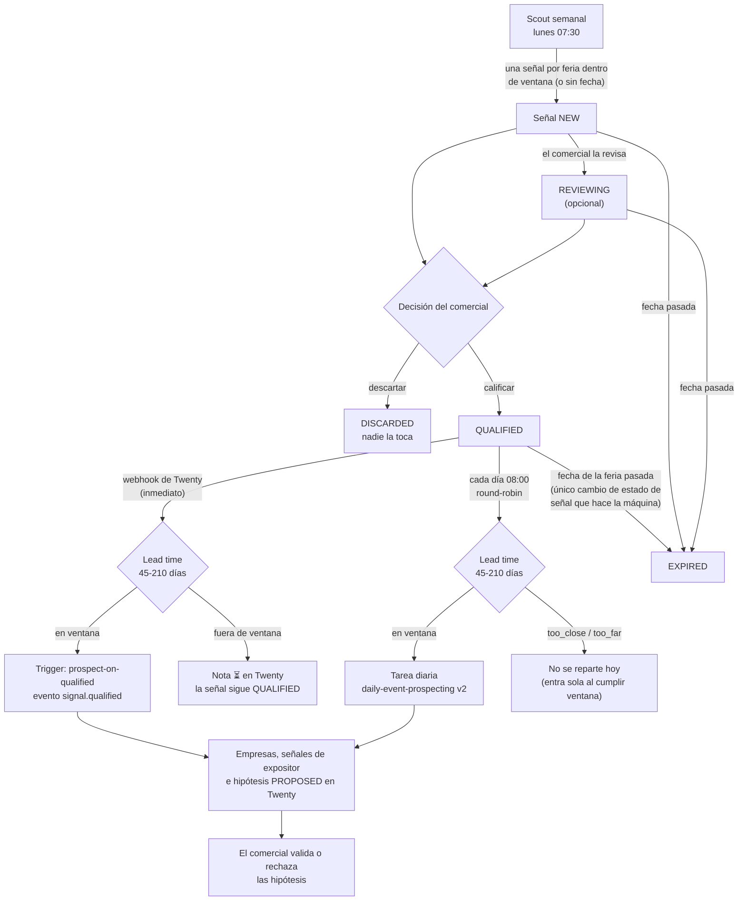
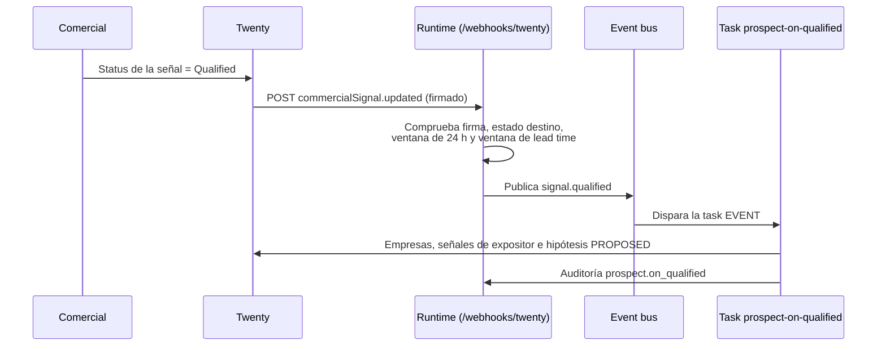

# Prospección guiada por señales: el ciclo completo

Hasta la tanda 14, la tarea diaria de las 08:00 evaluaba siempre la misma lista de expositores incrustada en el seed (una feria de ejemplo con dominios `.example`) y nunca buscaba nada nuevo. Las ferias reales se prospectaban a mano. Desde la tanda 15, **la prospección la guían las señales de feria** y el comercial es quien cualifica: la máquina descubre, tú decides qué merece trabajo, y la máquina trabaja solo lo que has calificado.

Este documento es técnico-operativo: describe el ciclo, cómo decide cada pieza y cómo se configura. Lo que ve y hace el comercial está en la [guía del equipo comercial](guia-comercial.md#señales-de-feria-tu-cola-de-decisión).

> **Nota:** este documento describe la especificación de las tandas 15 (el ciclo), 18 (la [ventana de lead time](#ventana-de-lead-time)) y 20 (el [Resolver de Dominios](resolver-dominios.md)). Los nombres exactos de tareas, eventos y variables son los del código y del [README del runtime](../runtime/agent-runtime/README.md); si alguno difiere, manda el README.

## Contenido

1. [El ciclo en una imagen](#el-ciclo-en-una-imagen)
1. [Estados de la señal y quién los cambia](#estados-de-la-señal-y-quién-los-cambia)
1. [Descubrir: el scout semanal](#descubrir-el-scout-semanal)
1. [Prospectar a diario, en modo señales](#prospectar-a-diario-en-modo-señales)
1. [Prospectar al calificar: el trigger inmediato](#prospectar-al-calificar-el-trigger-inmediato)
1. [Envejecimiento: señales que pasan a `EXPIRED`](#envejecimiento-señales-que-pasan-a-expired)
1. [Ventana de lead time](#ventana-de-lead-time)
1. [Configurar el webhook de `commercialSignal` en Twenty](#configurar-el-webhook-de-commercialsignal-en-twenty)
1. [Comprobar que funciona](#comprobar-que-funciona)
1. [Limitaciones](#limitaciones)
1. [Qué no hace](#qué-no-hace)
1. [Documentos relacionados](#documentos-relacionados)

## El ciclo en una imagen



Tres ideas sostienen el diseño:

- **El humano cualifica.** La máquina nunca decide que una feria merece trabajo. Calificar una señal es el único gesto que activa la prospección de esa feria.
- **Dos caminos hacia el mismo trabajo.** Al calificar, el trigger prospecta esa feria *al momento*. Además, la tarea diaria de las 08:00 reparte su presupuesto entre todas las señales `QUALIFIED` vigentes, así que una feria calificada sigue recibiendo trabajo los días siguientes.
- **Solo se trabaja lo que da tiempo a vender.** Una feria calificada solo recibe trabajo si su fecha cae dentro de la [ventana de lead time](#ventana-de-lead-time).
- **Sin señales calificadas en ventana no se gasta nada.** El run diario termina `SKIPPED` a coste 0.

## Estados de la señal y quién los cambia

| Estado | Significado | Quién lo pone |
|---|---|---|
| `NEW` | Feria descubierta, sin decidir. | El scout, al crearla |
| `REVIEWING` | El comercial la está mirando. Opcional. No dispara nada. | El comercial |
| `QUALIFIED` | Trabájala: se prospecta ya y entra en el reparto diario. | El comercial |
| `DISCARDED` | Ya no. No se prospecta ni se vuelve a mirar. | El comercial |
| `EXPIRED` | La fecha de la feria ya pasó. | **La máquina** (envejecimiento) |

`EXPIRED` es la **única escritura de estado de una señal que hace la máquina**. Nunca califica ni descarta.

**Señal de feria frente a señal de expositor.** El ciclo trabaja con señales a **nivel de evento**: una feria o un congreso, **sin empresa asociada**. Las señales por expositor (las que lleva una empresa y se titulan «feria — empresa», como las que el scout creó hasta la tanda 14) no disparan nada, ni al cambiar de estado ni en el reparto diario, y el comercial no tiene que gestionarlas.

## Descubrir: el scout semanal

La tarea `weekly-event-scouting` (lunes 07:30, `Europe/Madrid`) sigue buscando ferias reales del sector con grounding de Google Search. Lo que cambia en la tanda 15 es el resultado de lo que encuentra: **una señal de feria en estado `NEW` por cada feria descubierta**, con su fecha y su fuente, a la espera de que el comercial decida. Detalles del scout en [ADR-10](LLD-0.3-estado-real.md#adr-10) y [ADR-26](LLD-0.3-estado-real.md#adr-26).

Desde la tanda 18, el scout **no crea señales de ferias fuera de la [ventana de lead time](#ventana-de-lead-time)**: cuenta las que descarta en el output del run. Una feria sin fecha se crea igual.

Cada lunes, por tanto, el scout deja de ser el único camino de material nuevo: alimenta la cola de decisión, y el trabajo sobre cada feria lo desencadena la calificación, no el calendario.

## Prospectar a diario, en modo señales

La tarea `daily-event-prospecting` pasa a su **versión 2**. La versión anterior (con la feria de ejemplo del seed como entrada) no se borra: queda como versión histórica de la tarea, y la v2 ya no la lleva.

### Qué hace el run de las 08:00

1. **Lee las señales de feria** de Twenty (herramienta `list_event_signals`, solo señales sin empresa) y se queda con las `QUALIFIED` vigentes (fecha de la feria no pasada) **y dentro de la [ventana de lead time](#ventana-de-lead-time)**. Las `QUALIFIED` fuera de ventana se listan en el output como `too_close` o `too_far`, con sus días, y no entran en el reparto.
1. **Aplica el envejecimiento** (herramienta `expire_signal`; ver [más abajo](#envejecimiento-señales-que-pasan-a-expired)) y la [auto-expiración de hipótesis](#auto-expiración-de-hipótesis-proposed).
1. **Si no hay ninguna señal calificada vigente y en ventana, termina con `outcome` `SKIPPED`** y coste 0: no llama a ningún modelo.
1. **Reparte el presupuesto entre las señales**, por turnos (*round-robin*), empezando por **la señal menos trabajada**: la que lleva más tiempo sin recibir una pasada de prospección, o ninguna. Cada turno prospecta una feria; el reparto sigue hasta agotar el presupuesto del run.
1. **Escribe en Twenty** lo de siempre (empresa, señal de expositor, hipótesis `PROPOSED`) y deja el resumen de la ejecución (*Agent run*).

El presupuesto del run es el que ya limitaba la prospección (tiempo y número de expositores por ejecución): lo que cambia es que ahora se reparte entre varias ferias en lugar de gastarse sobre una sola.

### Por qué round-robin por la menos trabajada

Con una sola feria calificada, el comportamiento es el de siempre sobre esa feria. Con varias, evita que la primera de la lista consuma todo el presupuesto: cada día avanza la que va más atrasada, y ninguna se queda sin atender mientras haya otra que sí lo recibe.

### Expositores sin web: ya no se descartan a la primera

Los catálogos de las ferias suelen listar a los expositores por nombre, sin enlace a su web. Hasta la tanda 19, un expositor sin dominio acababa como `skipped_no_domain` en el primer pase (el caso del 2026-10-16: unos 110 bloqueados entre Anuga, Madrid Fusión y BWW). Desde la tanda 20, el Prospector **intenta resolver su web oficial antes de descartarlo**: busca el nombre, comprueba que la portada candidata corrobora la marca y descarta redes sociales, marketplaces y directorios. Si hay duda o empate, no resuelve (`domain_ambiguous`); si no hay web real, `domain_not_found`.

Un dominio resuelto devuelve al expositor a la evaluación normal: solo si resulta relevante se crea la empresa en Twenty, y siempre como hipótesis `PROPOSED` para que la valides tú. La resolución tiene un tope de búsquedas por run (`DOMAIN_RESOLVER_MAX_PER_RUN`, 25 por defecto): lo que no cabe queda `skipped_no_domain` y entra en el siguiente turno del reparto. Detalle, reglas y límites en [Resolver de Dominios](resolver-dominios.md).

## Prospectar al calificar: el trigger inmediato

Esperar a las 08:00 del día siguiente no tiene sentido cuando el comercial acaba de decidir que una feria merece trabajo. Por eso calificar dispara la prospección de esa feria al momento.



Piezas:

| Pieza | Qué es |
|---|---|
| Webhook de Twenty | Un `POST` por cada cambio o alta de una señal (`commercialSignal.updated` y `commercialSignal.created`), firmado con `TWENTY_WEBHOOK_SECRET`. Lo recibe el mismo endpoint `POST /webhooks/twenty` del feedback de hipótesis; el runtime enruta por el nombre del objeto. |
| Evento `signal.qualified` | Lo publica el runtime en el [event bus](n8n-integracion.md) cuando una señal de feria pasa a `QUALIFIED` y la ventana lo permite. Sus datos son `signal_id`, `name`, `event_url`, `event_date` y `signal_type`. También lo recibe n8n si hay suscripciones. |
| Task `prospect-on-qualified` | Task de tipo `EVENT` que escucha `signal.qualified` y lanza un scout dirigido a esa feria (modo `event_url`, con la URL de la señal). |
| Auditoría | Cada disparo queda en el `audit_log` como `prospect.on_qualified` (`GET /audit`). |

### Qué dispara y qué no

| Cambio en Twenty | ¿Dispara? |
|---|---|
| Señal de feria (sin empresa) pasa a `QUALIFIED`, con la feria dentro de la ventana de lead time | Sí |
| Señal de feria pasa a `QUALIFIED` con la feria fuera de ventana | No: deja una [nota ⏳](#qué-pasa-al-calificar-fuera-de-ventana) y conserva el `QUALIFIED` |
| Pasa a `REVIEWING` o `DISCARDED` | No |
| Se edita otro campo estando ya en `QUALIFIED` | No: solo cuenta la transición de estado |
| Señal por expositor (con empresa) pasa a `QUALIFIED` | No |
| La máquina la pasa a `EXPIRED` | No |

### Idempotencia y ventana de recalificación de 24 h

- **Como máximo una vez por señal cada 24 h.** El disparo se deduplica por la señal: si Twenty reenvía el mismo webhook, o el comercial cambia el estado y vuelve a `QUALIFIED` dentro de la ventana, la feria no se prospecta dos veces.
- **Ventana de recalificación de 24 h.** Pasada la ventana, una recalificación deliberada sí puede volver a disparar.
- **No hay reintentos de Twenty.** Si el webhook se pierde, no hay disparo inmediato. No se pierde el trabajo: la señal sigue `QUALIFIED` y el run de las 08:00 la recoge en el reparto.

## Envejecimiento: señales que pasan a `EXPIRED`

Cada run diario, antes de repartir (herramienta `expire_signal`), revisa las señales de feria no cerradas (`NEW`, `REVIEWING` y `QUALIFIED`) y pasa a **`EXPIRED`** las que tienen la fecha de la feria **anterior a hoy**. Es la única escritura de estado que hace la máquina.

- **Solo señales de feria con fecha.** Una señal sin fecha no caduca sola.
- **Solo hacia `EXPIRED`.** Vuelve a leer el registro justo antes de escribir, no toca `DISCARDED` y nunca califica, descarta ni reabre nada.
- **No borra nada.** La señal queda en Twenty con su historial. Una señal `EXPIRED` sale del reparto diario y deja de aparecer en la cola de decisión.

## Ventana de lead time

**Regla:** solo se trabaja una feria cuya fecha queda a entre 45 y 210 días de hoy, porque el merchandising necesita plazo para muestras, pruebas de marcaje y producción.

El 2026-10-12 el equipo comercial rechazó los seis primeros borradores listos para enviar, todos de expositores de una feria que se celebraba dos semanas después: con tan poco margen es imposible vender y producir un pedido, y las ferias que interesan son las del próximo trimestre. Esa decisión humana es la que codifica esta sección ([cómo se convirtió en regla](ciclo-mejora-skills.md#caso-canónico-el-rechazo-de-los-6-borradores-del-2026-10-12)).

### Las dos variables

| Variable | Defecto | Significado |
|---|---|---|
| `LEADTIME_MIN_DAYS` | `45` | Mínimo de días entre hoy y la feria. Con menos, la feria está demasiado cerca (`too_close`). |
| `LEADTIME_MAX_DAYS` | `210` | Máximo de días. Con más, la feria está demasiado lejos (`too_far`) y todavía no toca. |

Los días se cuentan en la zona horaria `Europe/Madrid`. Ambas variables se configuran como el resto del runtime ([lista](runbook-local.md#variables-del-runtime)).

### Qué pasa con una señal según los días

| Días hasta la feria | Etiqueta | Reparto diario (08:00) | Al calificar (trigger) | Scout de descubrimiento |
|---|---|---|---|---|
| De 45 a 210 | en ventana | Entra en el round-robin | Prospecta al momento | Crea la señal `NEW` |
| Menos de 45 | `too_close` | No entra; se lista con sus días | No prospecta: deja la [nota ⏳](#qué-pasa-al-calificar-fuera-de-ventana) | No crea la señal; suma al contador del output |
| Más de 210 | `too_far` | No entra; se lista con sus días | No prospecta: deja la nota ⏳ | No crea la señal; suma al contador del output |
| Sin fecha | — | Sin días que medir (ver nota) | Sin días que medir (ver nota) | Crea la señal igual |
| Fecha pasada | — | No entra; pasa a `EXPIRED` | No dispara | No crea la señal |

Una señal `QUALIFIED` fuera de ventana **conserva su estado**: no pasa a `EXPIRED` ni a `DISCARDED`. `EXPIRED` sigue reservado a las ferias cuya fecha ya pasó.

> **Nota:** una señal sin fecha no se puede medir contra la ventana. Si no quieres que una feria sin fecha consuma presupuesto, descártala o complétale la fecha.

### Qué pasa al calificar fuera de ventana

Cuando el comercial califica una señal de feria cuya fecha queda fuera de ventana, el trigger **no prospecta**. Deja en Twenty una **nota ⏳** con los días que faltan, la ventana vigente y qué ocurre a continuación. El estado `QUALIFIED` se conserva, así que:

- **Demasiado lejos (`too_far`):** la feria entra sola en el reparto diario el día en que su fecha entra en ventana (cuando quedan 210 días). No hay que volver a calificarla.
- **Demasiado cerca (`too_close`):** no se trabajará. La señal pasa a `EXPIRED` cuando la fecha pase, como cualquier otra.

La nota ⏳ es solo informativa: no es un fallo ni una orden pendiente.

### Auto-expiración de hipótesis (`PROPOSED`)

Las hipótesis `PROPOSED` de ferias que han quedado a menos de 45 días, o ya pasadas, no tienen sentido comercial. El run diario las pasa a **`EXPIRED`** antes de repartir.

- **Solo `PROPOSED`.** Una hipótesis `VALIDATED` no se auto-expira jamás: la aprobó una persona y solo otra persona la cambia.
- **Por vía de sistema, sin evaluación.** El cambio no crea ninguna evaluación `HUMAN`, y el webhook de Twenty deja de tratar `EXPIRED` como veredicto. Estas expiraciones no entran en la aceptación por versión, en los datasets ni en el Skill Optimizer: las métricas solo reflejan juicios del comercial.
- **No borra nada.** La hipótesis queda en Twenty con su historial.
- **Una feria lejana no expira nada.** Solo expiran las hipótesis por cercanía o por fecha pasada.

> **Importante:** para dar feedback que el sistema aprenda, usa `Validated` o `Rejected`. Un `EXPIRED` puesto a mano se guarda, pero ya no cuenta como veredicto.

## Configurar el webhook de `commercialSignal` en Twenty

El trigger necesita que Twenty avise al runtime cuando cambia una señal. Twenty no lo hace por defecto: hay que dar de alta el webhook **una vez**, a mano. Es una acción de configuración del operador (no la hace el runtime).

> **Importante:** es el **mismo webhook** del feedback de hipótesis (marca `pxos-runtime:human-feedback`): `pnpm register:webhook` lo actualiza en el sitio y suscribe por defecto `commercialHypothesis.updated`, `commercialSignal.updated` y `commercialSignal.created`. Prueba antes con `--dry-run`. El feedback de las hipótesis sigue funcionando por el mismo canal.

Requisitos previos, que ya cumple el entorno si el webhook de feedback funciona:

- `TWENTY_WEBHOOK_SECRET` (16 caracteres o más) definido en el runtime. Usa **el mismo valor** como secreto de este webhook.
- `OUTBOUND_HTTP_ALLOWED_INTERNAL_HOSTS=pxos-runtime,host.docker.internal` en el servidor y el worker de Twenty. Sin ella, Twenty descarta el envío sin registrar ningún error ([detalle](../runtime/agent-runtime/README.md#webhook-de-twenty)).

Pasos:

1. Abre Twenty y ve a **Settings → APIs & Webhooks → Webhooks → Create webhook** (en algunas versiones, el botón es **+ Create webhook**).
1. En **URL**, escribe `http://pxos-runtime:4020/webhooks/twenty`. Si el runtime corre en tu máquina con `pnpm dev`, usa `http://host.docker.internal:<puerto>/webhooks/twenty`.
1. En **Operations**, añade dos eventos al webhook del runtime: objeto **Signal** (`commercialSignal`) con **Updated** y con **Created** (una señal creada ya calificada también dispara; la ventana de 24 h evita duplicados). No suscribas más objetos.
1. En **Secret**, pega el valor de `TWENTY_WEBHOOK_SECRET`. No lo pongas en la URL (`?secret=`): Twenty escribe la URL completa en sus logs.
1. En **Description**, escribe `pxos-runtime:signal-qualified`, para reconocerlo luego.
1. Guarda.

> **Nota:** Twenty no tiene un estado "inactivo" para los webhooks. Para pausar el trigger inmediato sin borrarlo, vacía su lista de **Operations**; las señales calificadas siguen recibiendo trabajo en el run de las 08:00. No borres el webhook.

## Comprobar que funciona

1. Cambia a `QUALIFIED` una señal de feria de prueba con fecha futura.
1. En unos segundos, mira el `audit_log`: debe aparecer `prospect.on_qualified` con el identificador de la señal.

   ```bash
   curl -s "http://127.0.0.1:4020/audit?limit=20" -H 'x-tenant-id: publiexpe' | jq '.items[] | select(.action=="prospect.on_qualified")'
   ```

1. En Twenty, comprueba que hay un *Agent run* nuevo y, si la feria tenía expositores con encaje, hipótesis `Proposed`.
1. Si no aparece nada, revisa el destino del webhook en **Settings → APIs & Webhooks**, los [logs](runbook-local.md#dónde-mirar-los-logs) del runtime (`401` firma o secreto, `503` sin `TWENTY_WEBHOOK_SECRET`) y la variable `OUTBOUND_HTTP_ALLOWED_INTERNAL_HOSTS` de Twenty.
1. Sin señales calificadas, el run de las 08:00 de un día cualquiera debe terminar `SKIPPED`: es lo esperado, no un fallo.

## Limitaciones

- **Repetir una feria ya peinada solo recoge expositores nuevos.** El sistema deduplica por empresa y feria: una segunda pasada sobre la misma feria (el trigger y luego el reparto diario, o una recalificación) no repite lo ya escrito. Si el catálogo no ha cambiado, la pasada cuesta modelo y no aporta nada.
- **No hay tracking de "feria agotada".** El sistema no sabe que ha terminado con una feria. Una señal `QUALIFIED` sigue entrando en el reparto diario hasta que su fecha pasa (`EXPIRED`) o tú la descartas. Si ya has sacado de ella lo que querías, **descártala** para dejar de gastar presupuesto en ella.
- **La ventana de 24 h protege contra repeticiones accidentales, no contra el coste de recalificar a propósito.** Una recalificación fuera de ventana vuelve a lanzar la pasada completa.
- **El webhook no reintenta.** Un fallo de entrega pierde el disparo inmediato (el reparto de las 08:00 lo cubre al día siguiente).
- **Los umbrales del lead time son una regla comercial, no una medida.** Los 45 y 210 días recogen el criterio del equipo (muestras, pruebas de marcaje y producción); si cambia, se ajustan por variable de entorno ([las dos variables](#las-dos-variables)).
- **El envejecimiento y la ventana dependen de la fecha.** Una señal sin fecha, o con una fecha errónea, no caduca cuando debería.
- **Los expositores sin web se resuelven con un tope por run.** Un catálogo con muchos expositores sin dominio se desbloquea en varios runs, no en uno ([detalle](resolver-dominios.md#qué-pasa-al-agotar-el-presupuesto)).
- **El presupuesto diario es finito.** Con muchas ferias calificadas a la vez, cada una avanza más despacio: es el efecto del round-robin.

## Qué no hace

- **No califica ni descarta señales por su cuenta.** Solo pasa a `EXPIRED` las vencidas. Una señal calificada fuera de ventana no se descarta: espera.
- **No contacta con nadie.** Prospectar una feria deja empresas, señales de expositor e hipótesis `Proposed`; los correos siguen siendo cosa tuya ([borradores](guia-comercial.md#borradores-de-email)).
- **No borra nada.** Ni señales, ni la feria de ejemplo del seed (que simplemente deja de formar parte de la tarea, en una versión nueva).
- **No toca el canal de email** ni el [plan de warm-up](email-warmup.md).

## Documentos relacionados

- [Guía del equipo comercial](guia-comercial.md#señales-de-feria-tu-cola-de-decisión): qué ves y qué haces.
- [Runbook de operación local](runbook-local.md#webhook-de-commercialsignal-en-twenty): el paso de configuración del webhook y la operación diaria.
- [README del runtime: webhook de Twenty](../runtime/agent-runtime/README.md#webhook-de-twenty): firma, cabeceras y `register:webhook`.
- [Integración de eventos con n8n](n8n-integracion.md): el evento `signal.qualified` también puede consumirse desde n8n.
- [Ciclo de mejora de skills](ciclo-mejora-skills.md#caso-canónico-el-rechazo-de-los-6-borradores-del-2026-10-12): cómo el rechazo de los primeros borradores se convirtió en la regla de lead time.
- [Resolver de Dominios](resolver-dominios.md): cómo se resuelve la web de los expositores que el catálogo lista sin ella.
- [Roadmap](ROADMAP.md): lugar de las tandas 15 y 18 en el plan.
