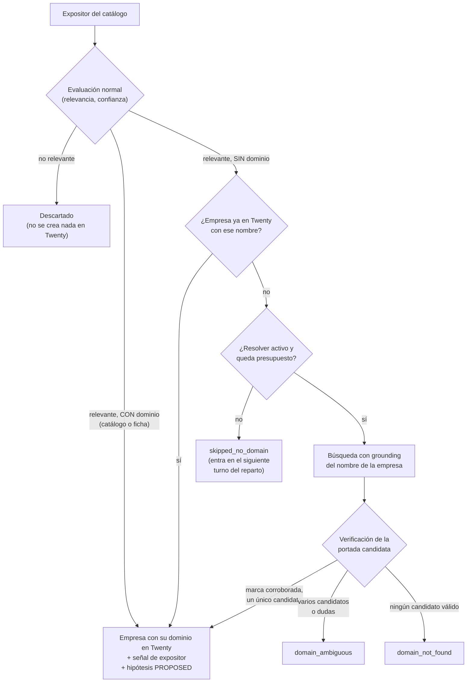

# Resolver de dominios: de un nombre de expositor a su web oficial

Los catálogos de expositores de las ferias suelen listar las empresas por nombre, sin enlace a su web. Hasta la tanda 19, el Prospector descartaba a cualquier expositor sin dominio (`skipped_no_domain`) porque sin web no puede crear la empresa en Twenty ni buscarle después un contacto. Desde la tanda 20, **antes de descartar a un expositor que la evaluación ya consideró relevante, intenta resolver su nombre a su web oficial** con un procedimiento determinista y verificado.

Este documento es técnico-operativo: describe qué resuelve, cómo decide, qué variables lo gobiernan y qué límites tiene. Lo que ve y hace el comercial está en la [guía del equipo comercial](guia-comercial.md#más-hipótesis-nuevas-cuando-se-desbloquean-expositores-sin-web).

> **Nota:** este documento está **reconciliado con la implementación** de la tanda 20. Los nombres exactos de variables, estados y campos del output son los del código y del [README del runtime](../runtime/agent-runtime/README.md); si alguno difiere, manda el README.

## Contenido

1. [Qué resuelve y por qué](#qué-resuelve-y-por-qué)
1. [Dónde encaja en el flujo del Prospector](#dónde-encaja-en-el-flujo-del-prospector)
1. [Cómo resuelve: búsqueda y verificación](#cómo-resuelve-búsqueda-y-verificación)
1. [Denylist: dominios que nunca se aceptan](#denylist-dominios-que-nunca-se-aceptan)
1. [En duda, no se resuelve](#en-duda-no-se-resuelve)
1. [Variables de entorno](#variables-de-entorno)
1. [Estados del output](#estados-del-output)
1. [Coste esperado](#coste-esperado)
1. [Qué pasa con la empresa en Twenty](#qué-pasa-con-la-empresa-en-twenty)
1. [Comprobar que funciona](#comprobar-que-funciona)
1. [Límites](#límites)
1. [Qué no hace](#qué-no-hace)
1. [Documentos relacionados](#documentos-relacionados)

## Qué resuelve y por qué

El problema es el hueco entre lo que publica una feria y lo que necesita el sistema. El catálogo de una feria dice «Conservas Fulano, S.L. — Salamanca — Alimentación»; el Prospector necesita `conservasfulano.es` para leer la web de la empresa, evaluar si encaja con el merchandising de PubliEXPE y, más tarde, [buscar su contacto](contactos.md).

El caso que motivó la tanda es del **2026-10-16**. Al peinar el catálogo de la edición 2026 de HIP, el Prospector evaluó a los expositores, pero **98 acabaron descartados por no tener dominio**. Y no era un caso aislado: en las ferias calificadas en ese momento había unos **110 expositores bloqueados** por la misma causa:

| Feria | Expositores `skipped_no_domain` |
|---|---|
| Anuga | 85 |
| Madrid Fusión | 16 |
| Barcelona Wine Week (BWW) | 9 |
| **Total** | **~110** |

Son ferias del próximo trimestre, dentro de la [ventana de lead time](prospeccion-por-senales.md#ventana-de-lead-time): exactamente las que el comercial ha calificado para trabajar. Descartar esos expositores no era un criterio comercial, era una limitación técnica.

> **Nota:** el lector de catálogos del scout (ver el [README del runtime](../runtime/agent-runtime/README.md)) ya intenta sacar la web de la **ficha individual** del expositor cuando el catálogo la publica ahí. El resolver actúa **después**, solo con lo que sigue sin dominio tras abrir la ficha: no la sustituye.

## Dónde encaja en el flujo del Prospector

El resolver se intercala en el pipeline por expositor, justo en el punto donde antes se descartaba:

Tres ideas sostienen el diseño:

- **Solo se busca lo que ya interesa.** La resolución va **después** de la evaluación de relevancia: la búsqueda solo se gasta en expositores que la evaluación ya consideró relevantes, y por eso un dominio resuelto desemboca directamente en la empresa y su hipótesis `PROPOSED` (que el comercial sigue validando, como siempre). Un expositor irrelevante nunca llega al resolver.
- **El presupuesto es del run.** La búsqueda cuesta; por eso cada pasada tiene un tope de búsquedas y lo que no cabe espera al siguiente turno ([detalle](#variables-de-entorno)).
- **Nunca se adivina.** Un dominio inventado o dudoso crea una empresa falsa en Twenty y, más tarde, un borrador a una dirección equivocada. Es peor que no resolver.

> **Nota:** si Twenty ya tiene una empresa con el nombre exacto del expositor, se reutiliza sin gastar búsqueda. Esa es también la vía manual: si un caso `domain_ambiguous` te interesa de verdad, crea tú la empresa en Twenty con ese nombre y su web, y la siguiente pasada la engancha.

## Cómo resuelve: búsqueda y verificación

El resolver es **determinista** en esta versión: usa heurísticas, no un modelo de lenguaje. La única llamada de modelo es la propia búsqueda con grounding.

### Paso 1: buscar candidatos

1. Lanza una **búsqueda con grounding de Google Search**, la misma que usa el scout de ferias (y con la misma contabilidad de coste), con el nombre del expositor —que viaja envuelto como contenido no confiable— y el país o la localidad que traiga la feria (o la región del scout) para acotar los homónimos.
1. De las **fuentes** de los resultados extrae los **dominios candidatos** (máximo 3; la web, no la página concreta). Las fuentes que llegan como redirecciones de Google se resuelven a su dominio final antes de nada. Si la búsqueda se ejecutó pero no trajo fuentes (un fallo conocido e intermitente del proveedor), la web que propone el modelo entra como candidato `search_unsourced`: sin privilegios, sometida a la misma verificación que cualquier otro.
1. Descarta los candidatos de la [denylist](#denylist-dominios-que-nunca-se-aceptan). Cada búsqueda tiene además un tope de 4 lecturas de página para verificar.

### Paso 2: verificar la portada

La búsqueda sola **no basta**: un resultado puede ser de otra empresa con nombre parecido. Para cada candidato que sobrevive, el resolver **descarga su portada** (con el mismo guard anti-SSRF y el mismo tratamiento de contenido no confiable que el resto de herramientas web del runtime) y comprueba que **corrobora la marca**:

| Dónde busca el nombre | Qué cuenta |
|---|---|
| `<title>` de la portada | El nombre de la empresa (sin la forma societaria: `S.L.`, `S.A.`, `GmbH`, `Ltd`…) aparece de forma reconocible |
| `<h1>` de la portada | Ídem |
| Aviso legal o pie de página | La razón social o el nombre comercial coincide con el del catálogo |

La comparación **normaliza** mayúsculas, tildes, signos y formas societarias antes de comparar. El listón de la v1 es doble y estricto: **el propio dominio tiene que llevar el nombre normalizado** y, además, la portada (o el aviso legal enlazado desde ella) tiene que corroborar la marca. Una tienda de terceros que pone la marca en su título no basta: queda como duda. Si la portada es un esqueleto JavaScript, se reintenta con el renderer, dentro de los límites de render existentes.

### Paso 3: registrar la fuente

Cuando un dominio se resuelve, el output guarda la **URL fuente de la verificación**: la página de la que salió la corroboración (la portada o la página de aviso legal). Esa URL es lo que permite auditar la decisión después, igual que el [Research de contacto](contactos.md#cómo-leer-el-research-de-contacto) guarda la página de origen de cada email.

## Denylist: dominios que nunca se aceptan

Hay dominios que aparecen en casi cualquier búsqueda de una empresa y **nunca son su web oficial**. La denylist es dura: un candidato de estas familias se descarta antes de verificar nada.

| Familia | Ejemplos |
|---|---|
| Redes sociales | `facebook.com`, `instagram.com`, `linkedin.com`, `x.com`, `twitter.com`, `youtube.com`, `tiktok.com`, `pinterest.com` |
| Marketplaces y tiendas de terceros | `amazon.*`, `alibaba.com`, `ebay.*`, `mercadolibre.*`, `wallapop.com` |
| Directorios de empresas | `europages.*`, `kompass.com`, `paginasamarillas.es`, `einforma.com`, `axesor.es`, `infoempresa.com`, `yelp.*` |
| Prensa y blogs | Diarios, revistas y portales de noticias |
| Enciclopedias y agregadores | `wikipedia.org`, `wikidata.org` |
| El dominio de la propia feria | El de la feria que se está peinando (por ejemplo, el de Anuga para un expositor de Anuga): un expositor aparece en el catálogo de la feria, pero la web de la feria no es la suya |

La lista vive en el **código** (`runtime/agent-runtime/src/agents/domain-resolver.ts`), no en una variable: ajustarla es un cambio revisable con tests, no un ajuste de configuración. Las familias son las de la tabla; los dominios concretos del código mandan.

> **Nota:** una empresa cuya única presencia es una página de Facebook o una ficha de Europages **no tiene dominio resoluble**. Es el caso `domain_not_found`: no se acepta una red social como si fuera su web.

## En duda, no se resuelve

La regla de oro del resolver es que **un falso positivo cuesta más que un falso negativo**. Por eso, ante cualquier duda, el expositor queda sin dominio:

- **Dos o más candidatos que superan la verificación** y no hay forma determinista de preferir uno (empate) → `domain_ambiguous`. No se elige «el primero» ni «el más probable».
- **Un candidato cuya portada no corrobora la marca**, o la corrobora solo de forma parcial o genérica → no se acepta.
- **Nombre demasiado genérico** (por ejemplo, «Alimentos del Norte»): la búsqueda devuelve decenas de empresas parecidas y ninguna destaca → `domain_ambiguous`.
- **La portada no se puede leer** (error de red, bloqueo, contenido que no carga) → no se acepta; no se resuelve «a ciegas».

> **Importante:** el resolver no desempata con un modelo de lenguaje. En `domain_ambiguous` no se crea nada en Twenty, y el output lista los candidatos que empataron (`domain_resolution.domain_candidates`) para que un humano pueda decidir. La vía manual: crea tú la empresa en Twenty con el nombre exacto del expositor y su web — la siguiente pasada la reutiliza sin buscar.

## Variables de entorno

| Variable | Defecto | Significado |
|---|---|---|
| `DOMAIN_RESOLVER_ENABLED` | `true` | Interruptor del resolver. Con `false`, todo expositor sin dominio vuelve a quedar en `skipped_no_domain` como antes de la tanda 20. |
| `DOMAIN_RESOLVER_MAX_PER_RUN` | `25` (rango 0–50) | Máximo de **búsquedas** de resolución por run. Al agotarse, los expositores que quedan sin intentar siguen como `skipped_no_domain` y entran en el siguiente turno del reparto. |

Ambas se configuran como el resto del runtime ([lista de variables](runbook-local.md#variables-del-runtime)): en `deployments/.env`, pasadas por el bloque `environment` de `pxos-runtime`, y se aplican recreando el servicio (`docker compose up -d pxos-runtime`).

### Qué pasa al agotar el presupuesto

El tope existe para que un catálogo con cientos de expositores sin web no dispare el coste de un solo run.

- Los primeros 25 expositores sin dominio del run se intentan resolver. El resto **no se descarta**: queda `skipped_no_domain`.
- Como la tarea diaria reparte su presupuesto por turnos entre las ferias calificadas ([round-robin](prospeccion-por-senales.md#prospectar-a-diario-en-modo-señales)), esa feria vuelve a recibir una pasada en un turno posterior. Los expositores ya resueltos (o ya clasificados como ambiguos o no encontrados) no se repiten; los que seguían sin intentar, sí.
- Por eso un catálogo de ~85 expositores sin web (Anuga) se completa **en varios runs**, no en uno. Es lo esperado, no un fallo.

Al agotar el tope, los expositores quedan sin intentar **en el orden del catálogo** (sin barajar). Un `domain_not_found` o `domain_ambiguous` **no es definitivo**: no se persiste veto alguno, así que una pasada posterior puede reintentarlo (con su coste); el tope por run contiene el gasto total.

## Estados del output

El output del run añade tres estados por expositor, además de los que ya existían (`skipped_no_domain`, descartes por relevancia, etc.):

| Estado | Significado | Qué ocurre después |
|---|---|---|
| `domain_resolved` | Se encontró un dominio y su portada corrobora la marca | El expositor —ya relevante— sigue el camino normal: empresa en Twenty e hipótesis `PROPOSED`. **No es un estado final**: va en `domain_resolution.status`, y el estado final del expositor es el de siempre (`hypothesis_created`…) |
| `domain_ambiguous` | Hay varios candidatos válidos o la verificación no es concluyente (estado final) | No se escribe nada en Twenty |
| `domain_not_found` | Ningún candidato sobrevive a la denylist y a la verificación (estado final) | No se escribe nada en Twenty |

Además, a nivel de **feria** existe `catalog_previous_edition`: si las fechas del catálogo (o los años de su URL o título) demuestran que pertenece a una edición ya celebrada frente a la fecha de la señal, la feria se corta por código **antes** del bucle por expositor — una sola extracción de coste, cero evaluaciones, contadores `events_previous_edition` y `exhibitors_skipped_previous_edition`, y la razón citando la URL del catálogo en el resumen del run. Es la versión por código de la regla de knowledge «catálogo de edición anterior» (nacida del caso HIP del 2026-10-16). Solo actúa cuando el run trae la fecha de la señal (reparto diario y disparo por calificación); el scout semanal no corta nada.

Ninguno de los estados cuenta como error ni convierte el run en `PARTIAL`. Cada expositor resuelto lleva en `domain_resolution` la **URL fuente de la verificación** (de dónde se corroboró la marca), de modo que cualquier dominio resuelto es auditable; en los casos sin resolver, `domain_resolution.domain_candidates` lista los candidatos encontrados. Si la empresa ya existía en Twenty con ese nombre, el caso se marca `existing_company` y no gasta búsqueda.

El resumen del run (el campo **Result** del *Agent run* en Twenty) incluye los contadores de los tres estados, además del número de búsquedas gastadas frente al tope.

## Coste esperado

La búsqueda con grounding es lo único que cuesta; la verificación (descargar una portada) no gasta modelo.

| Concepto | Orden de magnitud |
|---|---|
| Una búsqueda de resolución | Céntimos de euro |
| Pasar la mina actual (~110 expositores sin web, en varios runs) | **~1–2 €** en total |
| Un run con el tope por defecto (25 búsquedas) | Una fracción de ese total |

El coste de las búsquedas se **contabiliza en el run**: aparece en el campo **Cost** del *Agent run* y en las [métricas](runbook-local.md#variables-del-runtime) junto al resto del gasto del Prospector. Sale de un presupuesto que ya está acotado por `DOMAIN_RESOLVER_MAX_PER_RUN`, así que el peor caso de un run es predecible.

> **Nota:** dato medido en el estreno (2026-10-16, Anuga): un run con las 25 búsquedas del tope, 20 lecturas de verificación, 17 dominios resueltos y sus 17 hipótesis generadas costó **1,30 € en total** (resolución + evaluación + hipótesis). El coste por búsqueda depende del modelo y del precio vigente (consulta [model routing](model-routing.md)).

## Qué pasa con la empresa en Twenty

El resolver solo actúa sobre expositores que la evaluación **ya consideró relevantes** — los irrelevantes se descartan antes y nunca gastan búsqueda. Para un dominio resuelto se escribe lo mismo que para cualquier otro expositor relevante:

- La **empresa** con su dominio y el tenant `publiexpe`, deduplicada por dominio.
- La **señal de expositor** y la **hipótesis `PROPOSED`**, que cita la URL de la verificación en su evidencia.

Un `domain_ambiguous` o `domain_not_found` **no deja empresa ni hipótesis**. Así los ~110 expositores desbloqueados no inundan el CRM de empresas que no interesan: solo entran los relevantes con web verificada.

El flujo posterior es el de siempre: el comercial valida o rechaza la hipótesis; al validar, el sistema [busca el contacto](contactos.md) de la empresa y prepara el borrador.

## Comprobar que funciona

1. Con `DOMAIN_RESOLVER_ENABLED` sin tocar (`true`), lanza una pasada sobre una feria calificada que tuviera expositores `skipped_no_domain` (por ejemplo, desde el trigger de calificación o esperando al run de las 08:00).
1. Abre el *Agent run* en **Commercial OS → Agent runs** y lee el **Result**: debe mostrar contadores de `domain_resolved`, `domain_ambiguous` y `domain_not_found`, y las búsquedas usadas frente al tope.
1. Para una muestra de `domain_resolved`, abre la URL fuente de la verificación y confirma que la web es la de esa empresa. Si resuelves mal más de un caso de cada veinte, avisa al equipo técnico: es una señal de que la verificación es demasiado laxa.
1. Comprueba que solo las empresas relevantes tienen registro en **Companies** y que todas llevan dominio.
1. Si el resolver no hace nada, revisa `DOMAIN_RESOLVER_ENABLED` y que la variable llega al contenedor ([nota del runbook](runbook-local.md#variables-del-runtime)). Si los resultados son casi todo `domain_ambiguous` o `domain_not_found`, consulta [problemas frecuentes](runbook-local.md#problemas-frecuentes).

## Límites

- **Homónimos → ambiguo.** Varias empresas con el mismo nombre (o nombres muy genéricos) no se resuelven: el resolver prefiere no responder a elegir mal. Es el motivo más habitual de `domain_ambiguous`.
- **Empresas sin web real → `not_found`.** Un expositor cuya única presencia es una red social, un marketplace o un directorio no tiene dominio que resolver. Es un resultado correcto, no un error.
- **La verificación depende de que la portada sea legible.** Si la portada es un esqueleto JavaScript, se reintenta con el renderer (mismos límites de render que el resto del runtime); una web que bloquea las descargas queda sin resolver, no se acepta a ciegas.
- **Dominios que no llevan el nombre** (siglas o marcas abreviadas, tipo `incarlopa.es` para «Industrias Cárnicas Loriente Piqueras»): la v1 los deja en `domain_ambiguous` a propósito — es el precio del listón estricto contra falsos positivos.
- **Marcas distintas de la razón social.** Si el catálogo lista la razón social y la web muestra solo el nombre comercial (o al revés), la corroboración puede fallar. El aviso legal ayuda, pero no cubre todos los casos.
- **Sin modelo de lenguaje en v1.** El resolver no «razona» sobre el empate ni lee entre líneas: aplica heurísticas fijas. Es más predecible y más barato, a costa de resolver menos casos difíciles. Un desempate asistido por modelo, con verificación igualmente obligatoria, sería una ampliación futura.
- **El tope por run retrasa, no pierde.** Un catálogo grande se completa en varios runs.
- **No corrige dominios que ya vienen del catálogo.** Si el catálogo o la ficha traen un dominio, se usa tal cual; el resolver solo actúa cuando no hay ninguno.

## Qué no hace

- **No envía nada ni contacta con nadie.** Solo alimenta hipótesis `PROPOSED`. El humano sigue validando y el sistema sigue sin enviar ningún email.
- **No crea empresas por el mero hecho de resolver un dominio.** La evaluación decide.
- **No adivina.** En duda o empate, no resuelve.
- **No toca la base de datos.** No hay migraciones en esta tanda.
- **No usa un modelo de lenguaje para decidir** (solo para la búsqueda con grounding).
- **No borra nada** ni modifica empresas existentes.
- **No cambia las [ventanas de lead time](prospeccion-por-senales.md#ventana-de-lead-time)** ni el reparto del presupuesto entre ferias.

## Documentos relacionados

- [Prospección guiada por señales](prospeccion-por-senales.md): el ciclo en el que se integra el resolver.
- [Búsqueda de contactos](contactos.md): lo que ocurre después, cuando el comercial valida una hipótesis de una empresa con dominio resuelto.
- [Runbook de operación local](runbook-local.md#variables-del-runtime): las dos variables y los problemas frecuentes.
- [Guía del equipo comercial](guia-comercial.md#más-hipótesis-nuevas-cuando-se-desbloquean-expositores-sin-web): qué nota el comercial.
- [Model routing](model-routing.md): el modelo y el precio de la búsqueda.
- [README del runtime](../runtime/agent-runtime/README.md): referencia del código.
