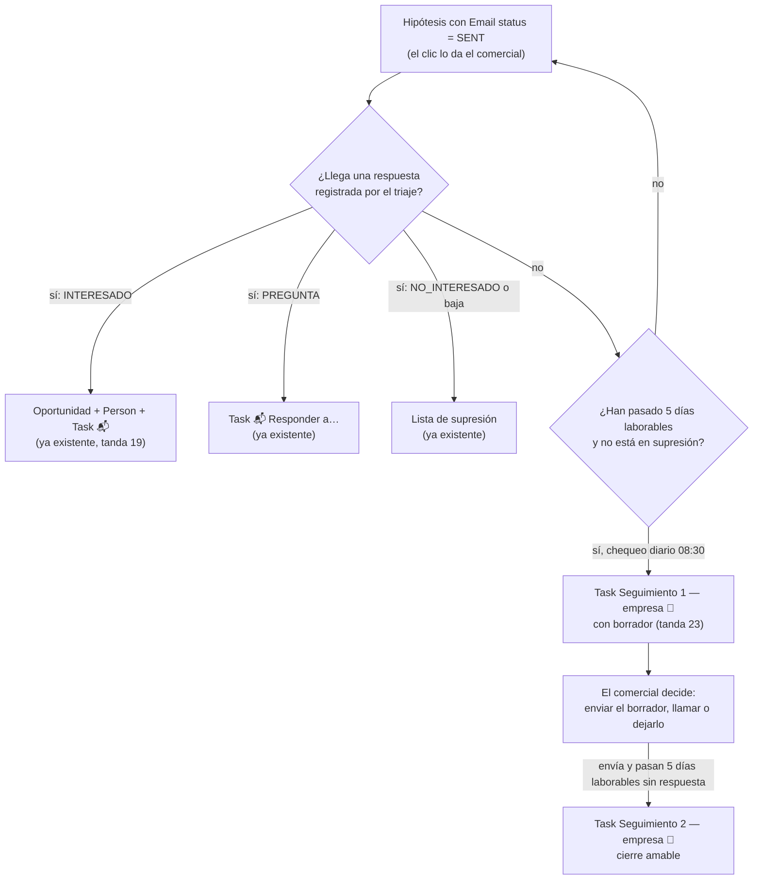

# Seguimiento de leads enviados

Hasta la tanda 20, el ciclo de un lead terminaba en el clic: pulsabas **Enviar borrador de email**, la hipótesis pasaba a `Sent` y, si el cliente no contestaba, el lead se perdía en silencio. Desde la tanda 21, **el sistema vigila los envíos sin respuesta y te deja una tarea de seguimiento** para que decidas tú si vuelves a escribir o llamas. Desde la tanda 23, esa tarea única pasa a ser una **secuencia de hasta 2 seguimientos, cada uno con su borrador redactado en el mismo hilo**: tú revisas y envías; el sistema prepara.

Este documento es técnico-operativo: describe el ciclo del lead después del envío, la regla de los 5 días laborables, qué hace y qué no hace el seguimiento y cómo comprobarlo. Lo que ve y hace el comercial está en la [guía del equipo comercial](guia-comercial.md#seguimiento-de-lo-que-has-enviado).

> **Nota:** este documento describe el diseño cerrado de la pieza B de la tanda 21 y su evolución en la tanda 23 (secuencias con borrador). Lo que cambió en la tanda 23 se marca como tal; el comportamiento de la tanda 21 (una sola Task con guion fijo) queda como histórico en las notas «Antes de la tanda 23». Lo que depende de la implementación va marcado `[POR CONFIRMAR]` y se reconcilia al integrar la tanda. Los nombres exactos de tareas, eventos y variables son los del código y del [README del runtime](../runtime/agent-runtime/README.md); si alguno difiere, manda el README.

## Contenido

1. [El ciclo del lead tras el clic](#el-ciclo-del-lead-tras-el-clic)
1. [La regla de los 5 días laborables](#la-regla-de-los-5-días-laborables)
1. [La secuencia de seguimientos (tanda 23)](#la-secuencia-de-seguimientos-tanda-23)
1. [La Task de seguimiento](#la-task-de-seguimiento)
1. [Qué hace y qué no hace](#qué-hace-y-qué-no-hace)
1. [La vista «Hipótesis · Envíos»](#la-vista-hipótesis--envíos)
1. [Configuración](#configuración)
1. [Comprobar que funciona](#comprobar-que-funciona)
1. [Limitaciones y deuda anotada](#limitaciones-y-deuda-anotada)
1. [Documentos relacionados](#documentos-relacionados)

## El ciclo del lead tras el clic

Después de que el correo sale (`Email status` = `Sent`), el lead sigue uno de dos caminos:



| Camino | Qué lo dispara | Qué aparece en Twenty | Dónde se documenta |
|---|---|---|---|
| **Respuesta con interés** | El [triaje del inbound](inbound-triaje.md) clasifica `INTERESADO` | Oportunidad, Person y Task 📬 «Responder a…» | [Twenty nativo](twenty-nativo.md#oportunidades) |
| **Pregunta** | El triaje clasifica `PREGUNTA` | Task 📬 «Responder a…» | [Triaje del inbound](inbound-triaje.md#clases-y-acciones) |
| **No interesado o baja** | El triaje clasifica `NO_INTERESADO` o detecta una baja | Línea nueva en la lista de supresión | [Warm-up: bajas](email-warmup.md#gestión-de-bajas-y-lista-de-supresión) |
| **Silencio** | Pasan 5 días laborables desde el último toque enviado sin respuesta registrada | **Task «Seguimiento 1 — empresa 🔔»** y, si sigue el silencio, **«Seguimiento 2 — empresa 🔔»** | Este documento |

Los tres primeros caminos ya existían y no cambian. El cuarto es lo nuevo de la tanda 21; en la tanda 23 pasa de un aviso a una secuencia.

## La regla de los 5 días laborables

Cada día a las **08:30** (`Europe/Madrid`), una tarea del scheduler revisa las hipótesis y crea la Task de seguimiento de las que cumplen **todas** estas condiciones:

1. **`Email status` = `Sent`.** Solo cuentan los correos que salieron de verdad.
1. **Han pasado al menos 5 días laborables desde el último toque enviado** (el primer envío o el seguimiento anterior; ver [la secuencia](#la-secuencia-de-seguimientos-tanda-23)). Los días laborables son de lunes a viernes; el cálculo no descuenta festivos (un puente puede adelantar el aviso un día). Un reenvío reinicia el reloj desde el último envío.
1. **No hay respuesta registrada.** El triaje del buzón no ha asociado ningún correo entrante a esa empresa o a ese envío. Cuenta como respuesta cualquier clase del triaje (interesado, pregunta, no interesado, baja u otro) **salvo la respuesta automática** (un «fuera de la oficina» no detiene el seguimiento). Un **rebote** sí lo detiene y además nunca genera Task: ese envío no llegó.
1. **El destinatario no está en la lista de supresión.** Ni la dirección ni el dominio.
1. **Ese toque de la secuencia no tiene ya su Task.** Ver [idempotencia](#idempotencia-una-task-por-hipótesis-para-siempre).

El plazo sale de la variable [`FOLLOWUP_AFTER_BUSINESS_DAYS`](#configuración) (5 por defecto).

### Idempotencia: una Task por hipótesis y toque, para siempre

> **Tanda 23:** el límite pasa de «una Task por hipótesis» a **una Task por hipótesis y por toque** (hasta `FOLLOWUP_MAX_TOUCHES`). Antes de la tanda 23 era una sola Task por hipótesis. `[POR CONFIRMAR]` el nombre de la entrada de `audit_log` de cada toque (el seguimiento de la tanda 21 usa `lead.followup_task`).

El sistema crea **como máximo una Task por cada toque de la secuencia, de por vida**. Da igual lo que hagas con ella:

- Si la cierras (`Done`), no se vuelve a crear.
- Si la borras a mano, no se vuelve a crear. El mecanismo: la marca de «ya creada» es la entrada `lead.followup_task` del `audit_log` del Agent OS (anclada a la hipótesis), no la propia Task, y por eso sobrevive al borrado.
- Si el chequeo se ejecuta dos veces el mismo día, la segunda no crea nada.

> **Importante:** pasado el último toque de la secuencia, el sistema no genera más. Si quieres seguir insistiendo, lo decides tú y lo haces tú.

## La secuencia de seguimientos (tanda 23)

> **Antes de la tanda 23:** el sistema creaba una sola Task 🔔 por hipótesis, con un guion fijo, y no continuaba el hilo. La secuencia lo sustituye; las Tasks 🔔 antiguas siguen existiendo y se reconocen.

Un envío sin respuesta genera **hasta 2 seguimientos** (`FOLLOWUP_MAX_TOUCHES`, 2 por defecto). Numeramos los toques desde el primer envío, así que el primer seguimiento es el toque 2 y el segundo, el toque 3.

| Task | Toque | Cuándo se crea | Qué lleva el borrador |
|---|---|---|---|
| **Seguimiento 1 — {empresa} 🔔** | 2 | 5 días laborables después del primer envío, sin respuesta | Recordatorio breve con un **ángulo nuevo de valor** |
| **Seguimiento 2 — {empresa} 🔔** | 3 | 5 días laborables después de que **envíes** el seguimiento 1, sin respuesta | **Cierre amable**, sin presionar |

Ambos borradores:

- tienen como asunto «Re: <asunto del primer envío>», para que el correo caiga **en el mismo hilo**;
- proponen una reunión con huecos del calendario, generados por código como en [la propuesta de reunión del AI Setter](ai-setter.md#la-propuesta-de-reunión);
- los redacta la skill versionada `email-followup-draft` (v1).

### La regla del último toque enviado

El plazo de 5 días laborables se cuenta desde el **último toque que enviaste**, no desde que se creó la Task. El sistema lo detecta en **los correos salientes que Twenty importa del buzón** (la misma sincronización de IONOS que usa el triaje).

1. Si **no enviaste** el toque anterior, **no se genera el siguiente**. Una Task «Seguimiento 1» sin enviar no dispara la «Seguimiento 2».
1. Si lo enviaste, el reloj de 5 días laborables arranca el día del envío.
1. Si el último toque no aparece en los salientes importados, el sistema lo trata como no enviado.

> **Importante:** esta regla evita encadenar recordatorios sobre un correo que el cliente nunca recibió. Para que funcione, el envío debe salir **desde la cuenta de correo conectada en Twenty**; un envío desde otro programa de correo o cuenta no queda registrado. `[POR CONFIRMAR]` si un envío manual desde el cliente de correo de IONOS cuenta siempre, según lo que Twenty importe.

### Cuándo se para la secuencia

La secuencia se detiene, sin generar más Tasks, cuando ocurre cualquiera de estas cosas:

- **Llega cualquier respuesta**, salvo las respuestas automáticas («fuera de la oficina»), que no la detienen.
- **Hay un rebote**: ese envío no llegó.
- **El destinatario causa baja** o entra en la lista de supresión.
- **Se alcanza `FOLLOWUP_MAX_TOUCHES`.**

## La Task de seguimiento

Es una **Task nativa de Twenty**, la misma que ya usas para **📬 Responder a…**, con este contenido:

| Elemento | Contenido |
|---|---|
| **Título** | `Seguimiento 1 — {empresa} 🔔` o `Seguimiento 2 — {empresa} 🔔` (texto primero, emoji al final: [por qué](#títulos-sin-emoji-delante)). Antes de la tanda 23: `🔔 Seguimiento — {empresa}` |
| **Vencimiento** | El día en que se crea (el del chequeo de las 08:30) |
| **Cuerpo** | Fecha y asunto del primer envío; destinatario; el ángulo de la hipótesis (qué se le propuso y por qué); y, desde la tanda 23, el **borrador del seguimiento** (antes: un guion sugerido fijo, sin urgencia) |
| **Enlace** | La Task cuelga de la empresa **y** de la hipótesis (si la hipótesis no tiene empresa, solo de la hipótesis) |

El borrador es una propuesta de texto, no un correo enviado (en la tanda 21 era un guion fijo por código). Su tono es el de «retomo el mensaje por si se perdió», nunca el de empujar: el ángulo comercial de PubliEXPE es el de ofrecer tiempo para hacerlo bien ([ventana de lead time](prospeccion-por-senales.md#ventana-de-lead-time)), no el de presionar. El guion de la tanda 21 era una plantilla fija por código, sin modelo; un test comprobaba que nunca contenía «plazo», «urgente» ni «prisa». `[POR CONFIRMAR]` si el borrador de la tanda 23, que sí usa modelo, mantiene esa comprobación en un test; el tono no cambia.

> **Nota:** como el resto de Tasks nativas, no lleva `tenantId` y la crea el runtime con el rol «Agent runtime» ([límite conocido](twenty-nativo.md#límites-conocidos)). El sistema nunca la cierra ni la borra.

### Títulos sin emoji delante

Twenty dibujaba un «?» en un rombo rojo como icono de las Tasks cuyo título empezaba por emoji. Desde la tanda 23 el título lleva el texto primero y el emoji al final. El sistema **sigue reconociendo las Tasks antiguas** con el emoji delante: no las duplica y no cuenta dos veces un toque.

## Qué hace y qué no hace

| Hace | No hace |
|---|---|
| Revisa cada día las hipótesis `Sent` y detecta las que llevan 5 días laborables sin respuesta | **No envía ningún correo.** Ni un seguimiento automático ni un recordatorio al cliente: el borrador lo envías tú |
| Crea una Task por toque (hasta 2) con fecha de ese día, el contexto y el **borrador** para que decidas | No repite la Task de un toque, aunque la cierres o la borres |
| Respeta la lista de supresión: a quien está en ella no se le hace seguimiento | No cambia el `Email status` ni el estado de la hipótesis |
| Deja una línea en el `audit_log` (`lead.followup_task`) por cada Task creada | No crea oportunidades ni mueve etapas del pipeline |
| Se detiene si llega una respuesta (salvo automáticas), un rebote o una baja | No cierra ni borra tus tareas |
| No genera el toque siguiente si no enviaste el anterior | No envía por ti para «desatascar» la secuencia |

> **Importante:** el seguimiento es **solo un aviso para ti**. Toda acción con efecto hacia fuera (escribir de nuevo, llamar) sigue exigiendo a una persona, como en el resto del sistema.

## La vista «Hipótesis · Envíos»

La Twenty App añade en la tanda 21 una vista de **Hypotheses**: **Hipótesis · Envíos**, un tablero kanban agrupado por **Email status**. Es el tablero de envíos del comercial: de un vistazo ve qué está en borrador, qué está revisado, qué se está enviando y qué ya salió.

| Columna | Significado |
|---|---|
| `Draft` | Borrador del sistema, sin revisar |
| `Reviewed` | Revisado por ti, listo para enviar |
| `Sending` | Envío en curso |
| `Sent` | El correo ha salido; aquí vive el seguimiento |

El tablero trae las columnas del enum real (`Draft`, `Ready`, `Sending`, `Sent`) más una columna para los valores vacíos (hipótesis sin borrador todavía).

La vista **no existe hasta que se sincroniza la App**. El sync lo hace la persona que opera Twenty con el procedimiento del runbook: [Qué añade la sincronización de la tanda 21](runbook-local.md#qué-añade-la-sincronización-de-la-tanda-21).

## Configuración

| Variable | Defecto | Significado |
|---|---|---|
| `FOLLOWUP_AFTER_BUSINESS_DAYS` | `5` | Días laborables sin respuesta tras el primer envío antes de crear la Task 🔔. Con `0`, el seguimiento queda **desactivado** y la tarea de las 08:30 no crea nada. Desde la tanda 23 el plazo se cuenta desde el último toque enviado |
| `FOLLOWUP_MAX_TOUCHES` | `2` | Seguimientos máximos por hipótesis (tanda 23). Con `2`: Seguimiento 1 y Seguimiento 2. `[POR CONFIRMAR]` el comportamiento con `0` y el tope admitido |

Como el resto de variables del runtime, se define en `deployments/.env`, debe llegar al bloque `environment` de `pxos-runtime` y se aplica recreando el servicio (`docker compose up -d pxos-runtime`): consulta la [lista de variables](runbook-local.md#variables-del-runtime).

> **Nota:** cambiar el plazo no reescribe nada. Si lo bajas de 5 a 3, la siguiente pasada crea las Tasks de las hipótesis que ya cumplen 3 días; las que ya tienen Task no se tocan.

> **Precaución:** la primera vez que se activa el seguimiento, **todas las hipótesis `Sent` antiguas sin respuesta cumplen la condición** y pueden generar Task el mismo día (por ejemplo, los envíos de las primeras semanas). El runtime limita la pasada a **20 Tasks** (las más antiguas primero); el resto sale como `cap_reached` y entra en los días siguientes. No hay tope de antigüedad.

La tarea se registra con el seed (`pnpm seed`), como el resto de tareas del Agent OS: La tarea es `lead-followup-check` (`CRON` `30 8 * * *` en `Europe/Madrid`, agente FollowUpAgent, sujeta a la allowlist `SCHEDULER_TENANTS`).

## Comprobar que funciona

1. Localiza una hipótesis `Sent` con más de 5 días laborables y sin respuesta, o ajusta `FOLLOWUP_AFTER_BUSINESS_DAYS` en un entorno de prueba para que alguna cumpla la regla.
1. Espera al chequeo de las 08:30 o lanza la tarea a mano: `curl -s -X POST http://127.0.0.1:4020/tasks/<TASK_ID>/run -H 'x-tenant-id: publiexpe' -H 'Content-Type: application/json' -d '{}'` Obtén el `<TASK_ID>` con `GET /tasks` (nombre `lead-followup-check`).
1. Comprueba el `audit_log`: debe aparecer `lead.followup_task` con el identificador de la hipótesis.

   ```bash
   curl -s "http://127.0.0.1:4020/audit?limit=20" -H 'x-tenant-id: publiexpe' | jq '.items[] | select(.action=="lead.followup_task")'
   ```

1. En Twenty, abre **Tareas → Tareas · Bandeja** y comprueba que hay una Task «Seguimiento 1 — {empresa} 🔔» con vencimiento de hoy, el cuerpo completo y el borrador con asunto «Re: …».
1. Para probar el segundo toque, envía el borrador desde la cuenta conectada en Twenty, espera a que se importe el saliente y deja pasar 5 días laborables (o baja `FOLLOWUP_AFTER_BUSINESS_DAYS` en un entorno de prueba). Debe aparecer «Seguimiento 2 — {empresa} 🔔». Sin el envío, no debe aparecer.
1. Repite el chequeo: no debe crearse una segunda Task para el mismo toque de la misma hipótesis.
1. Si no aparece nada, mira el *Agent run* de las 08:30 en **Commercial OS → Agent runs** y la fila «No se crean tasks de seguimiento» de los [problemas frecuentes](runbook-local.md#problemas-frecuentes).

> **Nota:** un día sin hipótesis que cumplan la regla es normal. La tarea debe terminar con cero creadas y a coste 0: el chequeo no usa modelo (cada hipótesis examinada sale en el output con su motivo: `too_recent`, `replied`, `bounced`, `task_exists`, `suppressed`, `cap_reached` o `no_send_record`).

## Limitaciones y deuda anotada

- **Sin envío automático.** El sistema prepara el borrador del seguimiento; lo envías tú (nivel 1 de autonomía del [AI Setter](ai-setter.md)). Un envío automático exigiría una decisión nueva del usuario y salvaguardas de reputación del dominio.
- **Deuda: hilo de email por hipótesis (parcialmente resuelta en la tanda 23).** El borrador usa «Re: <asunto del primer envío>» y el último toque se detecta en los salientes que Twenty importa, pero `[POR CONFIRMAR]` si el hilo (`Message-ID`) queda ligado a la hipótesis. Hasta la tanda 22, el sistema no guardaba el hilo (`Message-ID`) del primer envío ligado a la hipótesis. Por eso el seguimiento se apoya en la tabla de envíos y en el triaje del buzón, y por eso el guion no puede continuar el hilo original: lo que enviaste y lo que respondieron no cuelga de la hipótesis. Está anotada como deuda para una tanda posterior.
- **La detección de respuesta depende del triaje.** Si el buzón no sincroniza o el triaje no asocia una respuesta a su empresa (por ejemplo, contesta alguien desde otra dirección), el sistema creerá que no hay respuesta y creará la Task. Es un falso positivo inocuo: cierra la tarea.
- **Máximo 2 seguimientos por hipótesis.** Si necesita más, lo decides tú.
- **Depende de que Twenty importe los correos enviados.** Si no los importa, el sistema no ve tus envíos y no genera el seguimiento 2 (ver [problemas frecuentes](runbook-local.md#problemas-frecuentes)).
- **Los días laborables no descuentan festivos:** un puente largo puede adelantar un día el aviso.

## Documentos relacionados

- [Guía del equipo comercial](guia-comercial.md#seguimiento-de-lo-que-has-enviado): qué ves y qué haces con las Tasks de seguimiento.
- [AI Setter](ai-setter.md#tanda-b-secuencias-cualificación-y-huecos-con-plazo): la tanda B, de la que forman parte las secuencias.
- [Runbook de operación local](runbook-local.md#variables-del-runtime): la variable `FOLLOWUP_AFTER_BUSINESS_DAYS`, la sincronización de la vista y los problemas frecuentes.
- [Enviar los borradores desde Twenty](twenty-envio-email.md): cómo una hipótesis llega a `Sent`.
- [Triaje del inbound](inbound-triaje.md): cómo se registran las respuestas que detienen el seguimiento.
- [Twenty nativo](twenty-nativo.md): qué vive en cada pestaña, incluidas las Tasks.
- [Plan de warm-up](email-warmup.md): el ritmo de envío y la lista de supresión.
