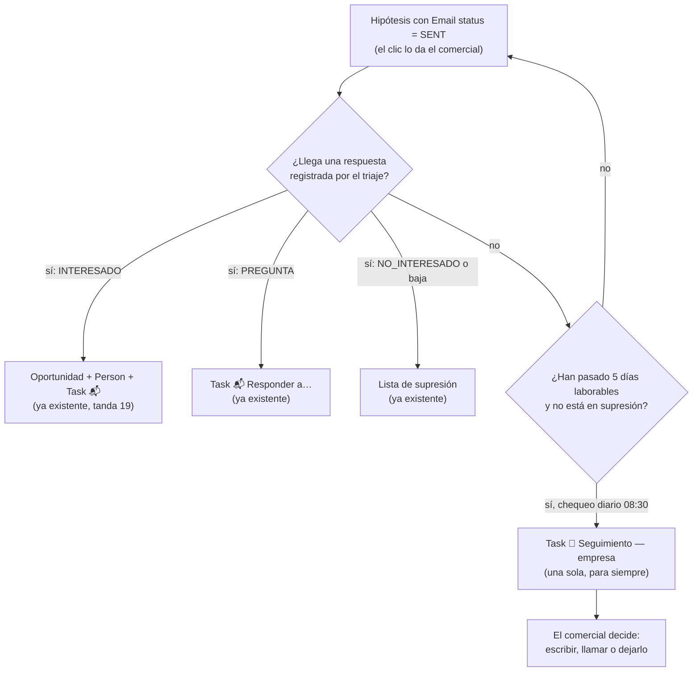

# Seguimiento de leads enviados

Hasta la tanda 20, el ciclo de un lead terminaba en el clic: pulsabas **Enviar borrador de email**, la hipótesis pasaba a `Sent` y, si el cliente no contestaba, el lead se perdía en silencio. Desde la tanda 21, **el sistema vigila los envíos sin respuesta y te deja una tarea de seguimiento** para que decidas tú si vuelves a escribir o llamas.

Este documento es técnico-operativo: describe el ciclo del lead después del envío, la regla de los 5 días laborables, qué hace y qué no hace el seguimiento y cómo comprobarlo. Lo que ve y hace el comercial está en la [guía del equipo comercial](guia-comercial.md#seguimiento-de-lo-que-has-enviado).

> **Nota:** este documento describe el diseño cerrado de la pieza B de la tanda 21. Lo que depende de la implementación va marcado `[POR CONFIRMAR]` y se reconcilia al integrar la tanda. Los nombres exactos de tareas, eventos y variables son los del código y del [README del runtime](../runtime/agent-runtime/README.md); si alguno difiere, manda el README.

## Contenido

1. [El ciclo del lead tras el clic](#el-ciclo-del-lead-tras-el-clic)
1. [La regla de los 5 días laborables](#la-regla-de-los-5-días-laborables)
1. [La Task de seguimiento](#la-task-de-seguimiento)
1. [Qué hace y qué no hace](#qué-hace-y-qué-no-hace)
1. [La vista «Hipótesis · Envíos»](#la-vista-hipótesis--envíos)
1. [Configuración](#configuración)
1. [Comprobar que funciona](#comprobar-que-funciona)
1. [Limitaciones y deuda anotada](#limitaciones-y-deuda-anotada)
1. [Documentos relacionados](#documentos-relacionados)

## El ciclo del lead tras el clic

Después de que el correo sale (`Email status` = `Sent`), el lead sigue uno de dos caminos:



| Camino | Qué lo dispara | Qué aparece en Twenty | Dónde se documenta |
|---|---|---|---|
| **Respuesta con interés** | El [triaje del inbound](inbound-triaje.md) clasifica `INTERESADO` | Oportunidad, Person y Task 📬 «Responder a…» | [Twenty nativo](twenty-nativo.md#oportunidades) |
| **Pregunta** | El triaje clasifica `PREGUNTA` | Task 📬 «Responder a…» | [Triaje del inbound](inbound-triaje.md#clases-y-acciones) |
| **No interesado o baja** | El triaje clasifica `NO_INTERESADO` o detecta una baja | Línea nueva en la lista de supresión | [Warm-up: bajas](email-warmup.md#gestión-de-bajas-y-lista-de-supresión) |
| **Silencio** | Pasan 5 días laborables desde el envío sin respuesta registrada | **Task 🔔 «Seguimiento — empresa»** | Este documento |

Los tres primeros caminos ya existían y no cambian. El cuarto es lo nuevo de la tanda 21.

## La regla de los 5 días laborables

Cada día a las **08:30** (`Europe/Madrid`), una tarea del scheduler revisa las hipótesis y crea la Task de seguimiento de las que cumplen **todas** estas condiciones:

1. **`Email status` = `Sent`.** Solo cuentan los correos que salieron de verdad.
1. **Han pasado al menos 5 días laborables desde el primer envío.** Los días laborables son de lunes a viernes; el cálculo no descuenta festivos (un puente puede adelantar el aviso un día). Un reenvío reinicia el reloj desde el último envío.
1. **No hay respuesta registrada.** El triaje del buzón no ha asociado ningún correo entrante a esa empresa o a ese envío. Cuenta como respuesta cualquier clase del triaje (interesado, pregunta, no interesado, baja u otro) **salvo la respuesta automática** (un «fuera de la oficina» no detiene el seguimiento). Un **rebote** sí lo detiene y además nunca genera Task: ese envío no llegó.
1. **El destinatario no está en la lista de supresión.** Ni la dirección ni el dominio.
1. **La hipótesis no tiene ya una Task de seguimiento.** Ver [idempotencia](#idempotencia-una-task-por-hipótesis-para-siempre).

El plazo sale de la variable [`FOLLOWUP_AFTER_BUSINESS_DAYS`](#configuración) (5 por defecto).

### Idempotencia: una Task por hipótesis, para siempre

El sistema crea **como máximo una Task de seguimiento por hipótesis, de por vida**. Da igual lo que hagas con ella:

- Si la cierras (`Done`), no se vuelve a crear.
- Si la borras a mano, no se vuelve a crear. El mecanismo: la marca de «ya creada» es la entrada `lead.followup_task` del `audit_log` del Agent OS (anclada a la hipótesis), no la propia Task, y por eso sobrevive al borrado.
- Si el chequeo se ejecuta dos veces el mismo día, la segunda no crea nada.

> **Importante:** el seguimiento es un único aviso por hipótesis, no una secuencia. Si pasado ese aviso quieres seguir insistiendo, lo decides tú y lo haces tú.

## La Task de seguimiento

Es una **Task nativa de Twenty**, la misma que ya usas para **📬 Responder a…**, con este contenido:

| Elemento | Contenido |
|---|---|
| **Título** | `🔔 Seguimiento — {empresa}` |
| **Vencimiento** | El día en que se crea (el del chequeo de las 08:30) |
| **Cuerpo** | Fecha y asunto del primer envío; destinatario; el ángulo de la hipótesis (qué se le propuso y por qué); y un **guion sugerido** para el seguimiento, sin urgencia |
| **Enlace** | La Task cuelga de la empresa **y** de la hipótesis (si la hipótesis no tiene empresa, solo de la hipótesis) |

El guion sugerido es una propuesta de texto, no un correo enviado. Su tono es el de «retomo el mensaje por si se perdió», nunca el de empujar: el ángulo comercial de PubliEXPE es el de ofrecer tiempo para hacerlo bien ([ventana de lead time](prospeccion-por-senales.md#ventana-de-lead-time)), no el de presionar. El guion es una plantilla fija por código, sin modelo; un test comprueba que nunca contiene «plazo», «urgente» ni «prisa».

> **Nota:** como el resto de Tasks nativas, no lleva `tenantId` y la crea el runtime con el rol «Agent runtime» ([límite conocido](twenty-nativo.md#límites-conocidos)). El sistema nunca la cierra ni la borra.

## Qué hace y qué no hace

| Hace | No hace |
|---|---|
| Revisa cada día las hipótesis `Sent` y detecta las que llevan 5 días laborables sin respuesta | **No envía ningún correo.** Ni un segundo email automático ni un recordatorio al cliente |
| Crea **una** Task 🔔 con fecha de ese día y el contexto para que decidas | No repite la Task: una por hipótesis, aunque la cierres o la borres |
| Respeta la lista de supresión: a quien está en ella no se le hace seguimiento | No cambia el `Email status` ni el estado de la hipótesis |
| Deja una línea en el `audit_log` (`lead.followup_task`) por cada Task creada | No crea oportunidades ni mueve etapas del pipeline |
| Se detiene si llega cualquier respuesta registrada | No cierra ni borra tus tareas |

> **Importante:** el seguimiento es **solo un aviso para ti**. Toda acción con efecto hacia fuera (escribir de nuevo, llamar) sigue exigiendo a una persona, como en el resto del sistema.

## La vista «Hipótesis · Envíos»

La Twenty App añade en la tanda 21 una vista de **Hypotheses**: **Hipótesis · Envíos**, un tablero kanban agrupado por **Email status**. Es el tablero de envíos del comercial: de un vistazo ve qué está en borrador, qué está revisado, qué se está enviando y qué ya salió.

| Columna | Significado |
|---|---|
| `Draft` | Borrador del sistema, sin revisar |
| `Reviewed` | Revisado por ti, listo para enviar |
| `Sending` | Envío en curso |
| `Sent` | El correo ha salido; aquí vive el seguimiento |

El tablero trae las columnas del enum real (`Draft`, `Ready`, `Sending`, `Sent`) más una columna para los valores vacíos (hipótesis sin borrador todavía).

La vista **no existe hasta que se sincroniza la App**. El sync lo hace la persona que opera Twenty con el procedimiento del runbook: [Qué añade la sincronización de la tanda 21](runbook-local.md#qué-añade-la-sincronización-de-la-tanda-21).

## Configuración

| Variable | Defecto | Significado |
|---|---|---|
| `FOLLOWUP_AFTER_BUSINESS_DAYS` | `5` | Días laborables sin respuesta tras el primer envío antes de crear la Task 🔔. Con `0`, el seguimiento queda **desactivado** y la tarea de las 08:30 no crea nada |

Como el resto de variables del runtime, se define en `deployments/.env`, debe llegar al bloque `environment` de `pxos-runtime` y se aplica recreando el servicio (`docker compose up -d pxos-runtime`): consulta la [lista de variables](runbook-local.md#variables-del-runtime).

> **Nota:** cambiar el plazo no reescribe nada. Si lo bajas de 5 a 3, la siguiente pasada crea las Tasks de las hipótesis que ya cumplen 3 días; las que ya tienen Task no se tocan.

> **Precaución:** la primera vez que se activa el seguimiento, **todas las hipótesis `Sent` antiguas sin respuesta cumplen la condición** y pueden generar Task el mismo día (por ejemplo, los envíos de las primeras semanas). El runtime limita la pasada a **20 Tasks** (las más antiguas primero); el resto sale como `cap_reached` y entra en los días siguientes. No hay tope de antigüedad.

La tarea se registra con el seed (`pnpm seed`), como el resto de tareas del Agent OS: La tarea es `lead-followup-check` (`CRON` `30 8 * * *` en `Europe/Madrid`, agente FollowUpAgent, sujeta a la allowlist `SCHEDULER_TENANTS`).

## Comprobar que funciona

1. Localiza una hipótesis `Sent` con más de 5 días laborables y sin respuesta, o ajusta `FOLLOWUP_AFTER_BUSINESS_DAYS` en un entorno de prueba para que alguna cumpla la regla.
1. Espera al chequeo de las 08:30 o lanza la tarea a mano: `curl -s -X POST http://127.0.0.1:4020/tasks/<TASK_ID>/run -H 'x-tenant-id: publiexpe' -H 'Content-Type: application/json' -d '{}'` Obtén el `<TASK_ID>` con `GET /tasks` (nombre `lead-followup-check`).
1. Comprueba el `audit_log`: debe aparecer `lead.followup_task` con el identificador de la hipótesis.

   ```bash
   curl -s "http://127.0.0.1:4020/audit?limit=20" -H 'x-tenant-id: publiexpe' | jq '.items[] | select(.action=="lead.followup_task")'
   ```

1. En Twenty, abre **Tareas → Tareas · Bandeja** y comprueba que hay una Task «🔔 Seguimiento — {empresa}» con vencimiento de hoy y el cuerpo completo.
1. Repite el chequeo: no debe crearse una segunda Task para la misma hipótesis.
1. Si no aparece nada, mira el *Agent run* de las 08:30 en **Commercial OS → Agent runs** y la fila «No se crean tasks de seguimiento» de los [problemas frecuentes](runbook-local.md#problemas-frecuentes).

> **Nota:** un día sin hipótesis que cumplan la regla es normal. La tarea debe terminar con cero creadas y a coste 0: el chequeo no usa modelo (cada hipótesis examinada sale en el output con su motivo: `too_recent`, `replied`, `bounced`, `task_exists`, `suppressed`, `cap_reached` o `no_send_record`).

## Limitaciones y deuda anotada

- **Sin segundo email automático.** La v1 solo avisa al comercial. Un segundo correo automático exigiría decidir contenido, frecuencia y salvaguardas de reputación del dominio, y queda fuera de esta tanda.
- **Deuda: hilo de email por hipótesis.** Hoy el sistema no guarda el hilo (`Message-ID`) del primer envío ligado a la hipótesis. Por eso el seguimiento se apoya en la tabla de envíos y en el triaje del buzón, y por eso el guion no puede continuar el hilo original: lo que enviaste y lo que respondieron no cuelga de la hipótesis. Está anotada como deuda para una tanda posterior.
- **La detección de respuesta depende del triaje.** Si el buzón no sincroniza o el triaje no asocia una respuesta a su empresa (por ejemplo, contesta alguien desde otra dirección), el sistema creerá que no hay respuesta y creará la Task. Es un falso positivo inocuo: cierra la tarea.
- **Una sola Task por hipótesis.** Si la hipótesis necesita un segundo seguimiento, lo decides tú.
- **Los días laborables no descuentan festivos:** un puente largo puede adelantar un día el aviso.

## Documentos relacionados

- [Guía del equipo comercial](guia-comercial.md#seguimiento-de-lo-que-has-enviado): qué ves y qué haces con la Task 🔔.
- [Runbook de operación local](runbook-local.md#variables-del-runtime): la variable `FOLLOWUP_AFTER_BUSINESS_DAYS`, la sincronización de la vista y los problemas frecuentes.
- [Enviar los borradores desde Twenty](twenty-envio-email.md): cómo una hipótesis llega a `Sent`.
- [Triaje del inbound](inbound-triaje.md): cómo se registran las respuestas que detienen el seguimiento.
- [Twenty nativo](twenty-nativo.md): qué vive en cada pestaña, incluidas las Tasks.
- [Plan de warm-up](email-warmup.md): el ritmo de envío y la lista de supresión.
