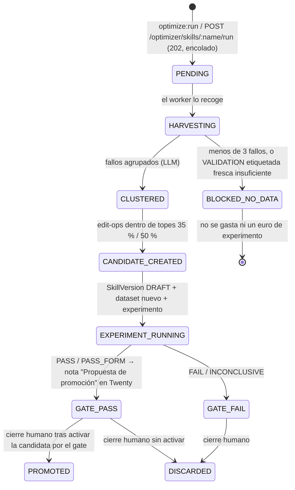

# Skill Optimizer: mejora automática de skills sobre el Release Gate

El Skill Optimizer es el modo automático del [ciclo de mejora de skills](ciclo-mejora-skills.md) (MVP-3 del [LLD v0.1](LLD-0.1-publiexpe-commercial-os.md#18-optimización-automática)). Con una sola orden recorre el camino que en EXP-001 y EXP-002 se hizo a mano: reúne los fallos reales de una skill, los agrupa, propone una candidata con operaciones acotadas, la mide contra la versión activa con un experimento y deja la decisión del [Release Gate](../runtime/agent-runtime/README.md#experiments-y-release-gate). Si el gate la deja pasar, deja una **propuesta de promoción** en Twenty para que una persona la revise.

Este documento es para quien decide (comercial y responsable técnico) y para quien opera el runtime. La referencia de endpoints y opciones está en el [README del runtime](../runtime/agent-runtime/README.md#skill-optimizer).

> **Importante:** el optimizador **nunca activa nada**. Un agente puede proponer, experimentar y evaluarse; la promoción a producción es siempre una decisión humana y la activación vuelve a comprobar el gate ([LLD §19](LLD-0.1-publiexpe-commercial-os.md#19-regla-de-oro-del-sistema-evolutivo)). Lo más lejos que llega una optimización es una versión `DRAFT` con un experimento `PASS` y una nota en Twenty.

> **Nota:** este documento describe la especificación de la tanda 11. Los nombres exactos de fases, estados y campos son los del README del runtime; si alguno difiere, manda el README.

## Qué dispara una optimización

Por ahora, **solo una persona**. No hay tarea programada: ninguna optimización arranca sola ni consume presupuesto sin que alguien la pida.

```sh
cd runtime/agent-runtime
pnpm optimize:run --skill prospector-event-exhibitors
```

La misma acción por API (runtime en `http://127.0.0.1:4020`):

```sh
curl -s -X POST "http://127.0.0.1:4020/optimizer/skills/prospector-event-exhibitors/run" -H 'x-tenant-id: publiexpe'
```

Cuándo tiene sentido lanzarla:

- Se han acumulado veredictos nuevos del equipo comercial (hipótesis aceptadas, editadas o descartadas en Twenty) desde la última optimización. Sin etiquetas frescas no hay con qué validar (consulta [BLOCKED_NO_DATA](#cuando-no-hay-datos-blocked_no_data)).
- La aceptación de una versión baja o aparece un patrón de fallo repetido que las reglas ya detectan.
- Se ha rehecho el dataset (`pnpm dataset:build`) y hay casos de validación sin quemar.

No tiene sentido lanzarla "por si acaso": cada vuelta cuesta dinero y quema casos de validación (P5).

## Fases y estados

Cada ejecución del optimizador es una fila de la tabla `optimization_runs` (migración 0013). Avanza por estas fases y deja el estado en cada una, de modo que puedes consultar dónde se quedó. Solo puede haber un run abierto por skill (un segundo `POST` responde `409`).



Además de estos estados existe `ERROR` (proveedor caído, topes rechazados dos veces, presupuesto agotado): queda registrado en la fila, con el detalle en `details`, y no deja ninguna versión activa. Los cierres humanos se hacen con `POST /optimizer/runs/:id/close` (`PROMOTED` exige que la candidata ya sea la versión activa — es decir, que alguien la haya activado pasando por el gate; `DISCARDED` en caso contrario).

| Fase | Qué hace | Qué sale |
|---|---|---|
| `HARVESTING` | Reúne los fallos de la versión activa desde dos fuentes, solo de trazas reales (ni stub ni `[TEST]`): evaluaciones humanas negativas (hipótesis descartadas o editadas, el último veredicto por hipótesis) y *hard-fails* de las reglas (RULE), sin gastar LLM. Comprueba además, **antes de gastar**, que habría suficientes casos de VALIDATION etiquetados y sin quemar (en simulación, descontando las entidades de los fallos) | Lista de fallos con su traza de origen; o `BLOCKED_NO_DATA` (por defecto pide ≥ 3 fallos y ≥ 5 casos frescos) |
| `CLUSTERED` | Un LLM agrupa los fallos por causa común (por ejemplo, "confianza inflada sin datos" o "suposiciones escritas como hechos") | Clusters con descripción y ejemplos citables |
| `CANDIDATE_CREATED` | El LLM propone operaciones `ADD`, `REMOVE`, `REPLACE`, `MOVE` y `REORDER` sobre la versión activa. La herramienta valida los topes y crea una `SkillVersion` en `DRAFT` cuyo *changelog* cita los clusters que corrige | Versión `DRAFT` con operaciones y justificación en `metadata` |
| `EXPERIMENT_RUNNING` | Construye la versión siguiente del dataset, marca como `design` (P5) los casos de las entidades que originaron los fallos, y lanza el [runner de experimentos](../runtime/agent-runtime/README.md#experiments-y-release-gate) existente: versión `ACTIVE` como baseline frente a la candidata | Dataset `DRAFT` nuevo + experimento `EXP-NNN` con su informe |
| `GATE_PASS` / `GATE_FAIL` | Copia la decisión del Release Gate | Con `PASS`: nota en Twenty. Con `FAIL`: nada más |

El optimizador reutiliza las piezas ya existentes: las operaciones acotadas son las de `pnpm skill:candidate`, y el experimento es el mismo que lanzas a mano con `pnpm experiment:run`. Por eso el resultado de una vuelta automática se lee igual que EXP-003.

### Consultar las ejecuciones

| Método y ruta | Qué devuelve |
|---|---|
| `GET /optimizer/runs` | Lista de optimizaciones con skill, estado, versión candidata, experimento y coste |
| `GET /optimizer/runs/:id` | Una optimización: clusters, operaciones propuestas, experimento enlazado y motivo del estado final |

## Guardarraíles

| Guardarraíl | Cómo se garantiza |
|---|---|
| **Nunca auto-promoción** | El optimizador no llama a `activate`. La activación es siempre manual y repite la comprobación del gate dentro de su transacción |
| **P5: nunca evaluar sobre lo que generó el cambio** | La cosecha respeta los casos quemados (`used_by`): lo que sirvió para diseñar una candidata no vuelve a servir para validarla. El experimento reserva `VALIDATION` con `markUsed` antes de ejecutar y aborta si hay contaminación |
| **Topes de edición** | Una candidata que borra o sustituye más del 35 % del texto base, o añade más del 50 %, se rechaza: eso sería reescribir la skill, no mejorarla |
| **Operaciones acotadas y justificadas** | Solo `ADD`, `REMOVE`, `REPLACE`, `MOVE` y `REORDER`, cada una anclada en texto único y con el cluster que la motiva |
| **Release Gate** | Composite ≥ baseline + 0,02, 0 fallos duros, *seesaw* (ninguna regla resuelta puede empeorar), coste/decisión ≤ ×1,25 y, con etiquetas, accuracy ≥ baseline |
| **Sin datos, sin experimento** | Si no hay casos etiquetados frescos suficientes, la ejecución termina en `BLOCKED_NO_DATA` antes de gastar presupuesto |
| **Regla de contenido no confiable** | Se conserva la `UNTRUSTED_SYSTEM_RULE`; la API avisa si una candidata la pierde |
| **Presupuesto** | El experimento usa su presupuesto en euros (ejecutor y juez) y se corta al agotarlo, con decisión `INCONCLUSIVE` si la medición queda incompleta |
| **Sin borrado** | Las candidatas descartadas quedan en `DEPRECATED` con su historial; no hay `DELETE` |

> **Nota:** que el gate dé `PASS` no obliga a activar. EXP-003 es el ejemplo contrario y también la prueba de que funciona: el gate rechazó la v4 del Prospector porque la mejora (Δ composite 0,007) no llegaba al mínimo de 0,02 y porque el juez vio que la candidata inventaba "notoriedad contrastada". Una mejora aparente sin respaldo no pasa.

### Cuando no hay datos: `BLOCKED_NO_DATA`

El `VALIDATION` de `prospeccion-v1` se quemó en EXP-003, y los cinco veredictos reales iniciales están quemados como datos de diseño de EXP-001. Hasta que haya veredictos humanos nuevos, el optimizador puede terminar en `BLOCKED_NO_DATA`. No es un fallo: es el sistema negándose a validar sobre datos que ya vio.

Para desbloquearlo:

1. El equipo comercial sigue validando, editando o descartando hipótesis en Twenty como en su [rutina diaria](guia-comercial.md). Cada decisión queda registrada como evaluación humana.
1. Se vuelve a lanzar `pnpm optimize:run`: el propio optimizador construye la versión siguiente del dataset con los veredictos nuevos antes del experimento (también puede hacerse a mano con `pnpm dataset:build`). El mensaje del `BLOCKED_NO_DATA` dice cuántos casos faltan y cuántos están quemados.

Los scouts de los lunes (el primero automático, el 2026-10-12) generan hipótesis nuevas; solo se convierten en casos etiquetados cuando una persona las revisa.

## Revisar una "Propuesta de promoción" en Twenty

Cuando una optimización termina en `GATE_PASS`, el runtime crea una nota en Twenty titulada **Propuesta de promoción**. Es un aviso para una persona, no una acción pendiente: si no haces nada, no pasa nada.

Qué debes encontrar en la nota (y qué hacer con cada parte):

1. **Skill y versiones**: skill, versión activa (baseline) y versión candidata. Confirma que la baseline sigue siendo la activa; si alguien activó otra versión mientras tanto, el gate bloqueará la activación y habrá que repetir el experimento.
1. **Qué cambia y por qué**: el *changelog* de la candidata cita los clusters de fallos. Comprueba que cada cluster es un problema real que reconoces del trabajo diario.
1. **Resultado del gate**: decisión (`PASS` o `PASS_FORM`), cada criterio con su valor y el coste del experimento. `PASS_FORM` significa que no había etiquetas para medir si las decisiones aciertan: es válido para activar, pero queda pendiente de revalidar.
1. **Enlaces**: el informe `EXP-NNN` (tabla lado a lado por expositor) y la versión `DRAFT` con su diff.

Lista de revisión:

- [ ] Leí el diff de la candidata: cambia lo que dice el changelog y nada más.
- [ ] Leí las razones por expositor del informe, no solo las métricas. Las métricas no lo ven todo (EXP-003 lo demostró).
- [ ] La candidata no inventa datos ni eleva la confianza sin respaldo.
- [ ] Si el gate fue `PASS_FORM`, acepto que falta revalidar con etiquetas o, mejor, uso el [canario](#canario-despliegue-gradual-tras-el-gate). Cuando haya veredictos nuevos, la revalidación es `POST /experiments/EXP-NNN/revalidate` ([ciclo](ciclo-mejora-skills.md#revalida-un-pass_form-cuando-lleguen-etiquetas)).
- [ ] Sé cómo deshacerlo (rollback, más abajo).

### Decidir

| Decisión | Cuándo | Cómo |
|---|---|---|
| **Activar** | La lectura cualitativa confirma el resultado del gate | Comando de activación (siguiente apartado) |
| **Probar con canario** | El gate dio `PASS_FORM`, o el cambio afecta al tono o a la presentación | [Canario](#canario-despliegue-gradual-tras-el-gate) |
| **Descartar** | No convence, aunque el gate pase | `POST /skills/<skill>/versions/<v>/deprecate` |
| **Iterar** | Corrige algo pero falta otra cosa | Crea una candidata a mano con `pnpm skill:candidate` y valídala con datos nuevos ([ciclo manual](ciclo-mejora-skills.md)) |

### Activar

Solo una persona, después de leer la propuesta:

```sh
curl -s -X POST "http://127.0.0.1:4020/skills/<skill>/versions/<v>/activate" -H 'x-tenant-id: publiexpe'
```

La activación **repite la comprobación del gate**: el último experimento `COMPLETED` de esa versión contra la versión activa actual debe haber dado `PASS` o `PASS_FORM`. Si no, responde `409 release_gate_blocked`. Forzar la activación es posible solo con `force` y un motivo (mínimo 10 caracteres) que queda en el log y en la respuesta; úsalo con criterio, porque salta la protección que el optimizador respeta.

Después, mide la aceptación por versión como se explica en el [paso 7 del ciclo](ciclo-mejora-skills.md#7-mide-la-aceptación-por-versión).

## Canario: despliegue gradual tras el gate

El gate decide con un puñado de casos y repeticiones controladas. El canario es el siguiente escalón de seguridad ([LLD §11.7](LLD-0.1-publiexpe-commercial-os.md#117-canary-y-rollback)): en lugar de pasar de 0 a 100 %, la candidata atiende un porcentaje del tráfico real durante un tiempo y se compara con la activa antes de decidir.

Cómo funciona:

- `POST /skills/:name/versions/:v/canary` con `{ "percent": 20 }` (1-99) pone la versión en canario. La versión debe haber pasado el gate (`PASS` o `PASS_FORM`; un rollback no admite canario) y aquí no existe `force`. El porcentaje no se cambia en caliente: para otro porcentaje, rollback y canario nuevo.
- El reparto es **determinista**: se decide por un hash del id del task run (o de la ejecución directa). Una misma ejecución cae siempre en el mismo grupo, aunque se reintente, y la comparación no depende del azar de cada llamada. La traza registra rama y clave (P4).
- Solo puede haber **una canaria por skill** a la vez; mientras exista, la activación normal de esa skill responde `409`, y deprecar la canaria o la estable cierra el canario.
- `GET /skills/:name/canary` devuelve la comparativa entre la versión activa y la canaria (volumen, resultado, coste, latencia, último veredicto humano y el delta canaria − estable).
- Al terminar, `POST /skills/:name/canary/promote` convierte la canaria en la versión activa (re-verifica el gate) y `POST /skills/:name/canary/rollback` la retira (siempre permitido e idempotente); la versión activa nunca dejó de estar disponible. En ambos casos decide una persona: el sistema no promueve ni retira solo.

Cuándo usarlo:

- El gate fue `PASS_FORM` y no hay etiquetas con las que confirmar la accuracy. Si mientras dura el canario llegan veredictos y la revalidación da `REFUTED`, verás la nota «⚠️ Revalidación fallida» en Twenty: el rollback es `POST /skills/:name/canary/rollback`.
- El cambio toca la forma de los mensajes (tono, confianza, presentación) y quieres verlo con hipótesis reales antes de generalizarlo.
- La skill tiene mucho volumen o un fallo costaría caro.

Cuándo no hace falta: cambios triviales con `PASS` estricto, o skills con tan poco tráfico que el canario nunca reuniría datos.

> **Nota:** el [ciclo manual](ciclo-mejora-skills.md#7-mide-la-aceptación-por-versión) pide al menos 30 hipótesis revisadas por versión antes de concluir. Un canario del 10 % tarda mucho en llegar a esa cifra con el volumen actual (unas decenas de hipótesis por scout semanal). Usa un porcentaje mayor (20-50 %) o acepta que la comparativa será orientativa.

El mismo mecanismo de gate protege ahora a las versiones de **harness**: activar una versión de harness exige un experimento con `PASS` o `PASS_FORM`, o `force` con motivo; sin ello responde `409 release_gate_blocked`.

## Rollback

El rollback no pasa por el gate, igual que en el ciclo manual:

```sh
# La versión activa pasa a DEPRECATED y vuelve la que estaba activa antes.
curl -s -X POST "http://127.0.0.1:4020/skills/<skill>/versions/<v>/deprecate" -H 'x-tenant-id: publiexpe'
```

Si la versión estaba en canario, el rollback del canario la retira sin tocar la versión activa. No se borra nada: lo descartado queda en `DEPRECATED`.

## Costes orientativos

Con Gemini, los experimentos previos costaron entre 0,10 y 0,15 € (EXP-001 0,09 € de validación; EXP-003 0,14 €: 0,085 € del ejecutor y 0,058 € del juez). El coste de una optimización completa es esencialmente el del experimento, más dos llamadas de texto para agrupar fallos y proponer operaciones, del orden de céntimos. Cuenta, por tanto, con **entre 0,10 y 0,20 € por vuelta completa**.

| Resultado | Gasto típico |
|---|---|
| `BLOCKED_NO_DATA` | Prácticamente nulo: termina antes del experimento |
| `GATE_FAIL` / `GATE_PASS` | Experimento (0,10-0,15 €) más agrupación y propuesta |
| Abortada por presupuesto | Lo gastado hasta el corte, marcado `INCONCLUSIVE` |

> **Nota:** son cifras de referencia con `gemini-flash-latest` como ejecutor y `gemini-pro-latest` como juez. El coste real de cada vuelta está en `GET /optimizer/runs/:id` y en el informe del experimento. El 2027-01-01 sube el precio de gemini-3.8-flash: revisa estas cifras entonces (consulta el [roadmap](ROADMAP.md#hitos-de-calendario-no-perder)).

## Qué no hace (todavía)

- No se ejecuta de forma programada: solo manual.
- No optimiza harness ni router: solo skills. Las versiones de harness se protegen con el gate, pero no tienen optimizador propio.
- No sustituye a la revisión humana ni a la medición posterior por versión.
- Hoy solo hay *runner* de experimentos para `prospector-event-exhibitors`, así que es la única skill optimizable de punta a punta.

## Documentos relacionados

- [Ciclo de mejora de skills](ciclo-mejora-skills.md): el procedimiento manual, que sigue siendo válido como alternativa.
- [README del runtime](../runtime/agent-runtime/README.md): [Skills](../runtime/agent-runtime/README.md#skills), [Datasets de evaluación](../runtime/agent-runtime/README.md#datasets-de-evaluación) y [Experiments y Release Gate](../runtime/agent-runtime/README.md#experiments-y-release-gate).
- [README de la Twenty App](../apps/twenty-app/README.md): dónde se ven las notas y las hipótesis.
- [EXP-003](experimentos/EXP-003-prospector-v4.md): el primer experimento automático y un rechazo del gate explicado.
- [LLD v0.1](LLD-0.1-publiexpe-commercial-os.md): §6.3 (skills), §11.5-11.7 (experimentos, gate, canario), §18 (optimización) y §19 (regla de oro).
- [Roadmap](ROADMAP.md): lugar del MVP-3 en el plan.
